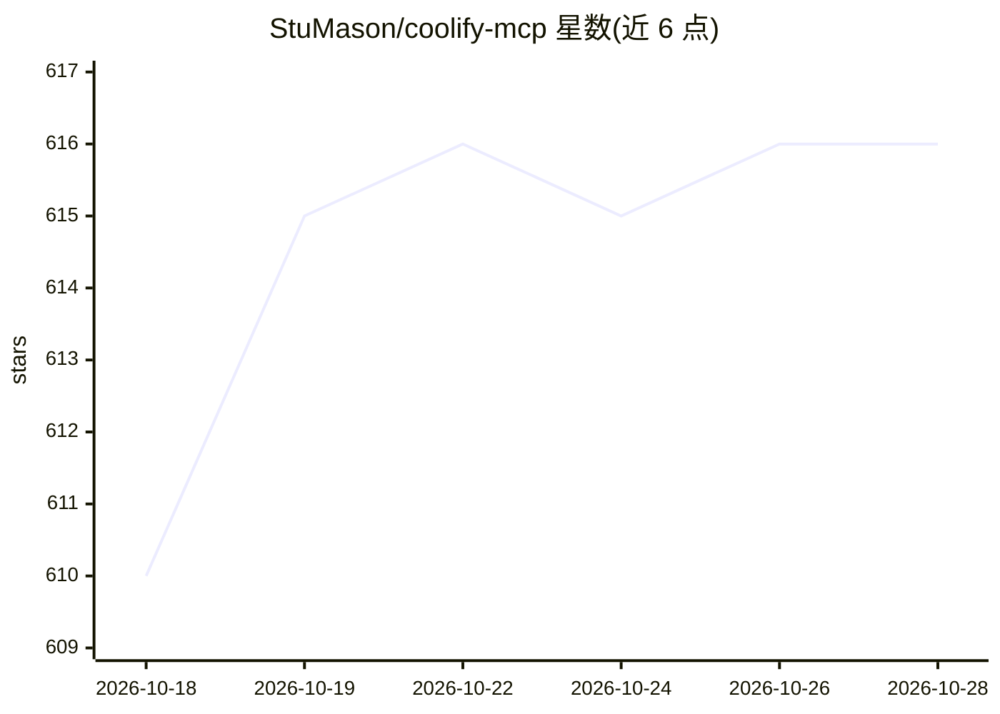

# StuMason/coolify-mcp

⭐ 616 · TypeScript · MIT · 推送 2026-10-27 · [GitHub](https://github.com/StuMason/coolify-mcp) · [官网](https://coolify-mcp.stumason.dev) · 个人维护

**MCP server：通过 AI 客户端用自然语言管理 Coolify 自托管 PaaS**

TypeScript 实现的 MCP 服务器，通过 46 个工具让 Claude、Cursor 等 MCP 客户端以自然语言对 Coolify v4 自托管 PaaS 进行部署、诊断、启停、创建/销毁应用与数据库（8 引擎）、批量操作与文档检索。破坏性操作前需人工确认并标明影响范围，秘密默认掩码，日志输出按不可信数据包裹。支持 stdio 与 HTTP 两种传输、多实例 fleet 模式、OAuth 2.1 远程模式及 doctor 配置诊断命令。以 npx、Claude Desktop 一键扩展包或容器方式安装。

## 筛选速览

| 维度 | 判定 | 备注 |
|---|---|---|
| AI 角色 | `ai-ecosystem` | LLM/agent 周边工具 |
| 许可风险 | `permissive` | MIT |
| 部署形态 | `self-host` | docker 或自建部署 |
| 模型依赖 | — | README 未给出锁定关系 |
| 硬件要求 | — | 无带数字的原话,不猜 |
| 安装摩擦 | `low` | 无编译、无系统依赖或容器化 |
| 成熟度 | — | 结构信号不足 |

## 能力要点

- 46 个工具覆盖部署、诊断、配置与批量操作，工具列表约 8,900 tokens
- 破坏性操作人工确认并标明影响范围，HTTP 模式下防护失败即关闭
- doctor 一条命令检查配置、连通性、令牌与 Coolify 版本
- 支持多 Coolify 实例（fleet 模式）与 OAuth 2.1 远程 HTTP 模式

## 适用场景

- 通过对话让 Claude/Cursor 诊断和部署 Coolify 上的应用
- 一次连接管理多个客户的 Coolify 实例
- 对生产环境做带人工确认门禁的破坏性操作

## 场景标签

 · 领域:开发运维/基础设施管理

## 证据(README 行号)

> L11: Manage Coolify from Claude, Cursor, or any MCP client: 46 tools for deploying, debugging, and operating your self-h
> L24: claude mcp add coolify \

## 星数曲线

2026-10-18 610 → 2026-10-28 616（+6）

---
*卡片 v1 · prompt 1.4 · 生成 2026-10-21 · 置信度 mid · 依据 README sha `b9da0e9a4b56` · [字段定义](../../DATASET.md)*
