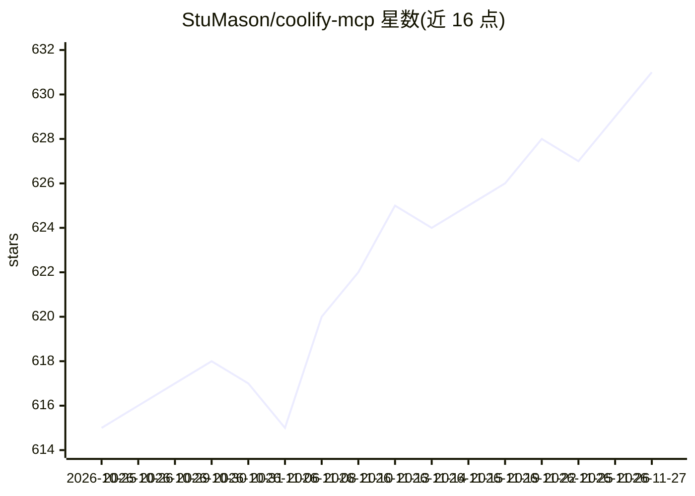

# StuMason/coolify-mcp

⭐ 631 · TypeScript · MIT · 推送 2026-11-26 · [GitHub](https://github.com/StuMason/coolify-mcp) · [官网](https://coolify-mcp.stumason.dev) · 个人维护

**让 AI 客户端用自然语言管理自托管 PaaS Coolify 的 MCP 服务器**

面向 Claude Desktop、Claude Code、Cursor 等 MCP 客户端的服务器，通过 46 个工具以自然语言执行 Coolify 自托管 PaaS 的部署、诊断与运维：读取容器日志、部署回滚、管理应用/数据库/项目/环境变量/备份，破坏性操作前向用户确认，密钥默认掩码。支持 Claude Desktop 一键安装包、npx 本地运行或部署为 Coolify 内容器（HTTP/OAuth 2.1）。需运行中的 Coolify v4.0–4.3 实例及 API token；内置 doctor 自检命令，支持多实例 fleet 模式。

## 筛选速览

| 维度 | 判定 | 备注 |
|---|---|---|
| AI 角色 | `ai-ecosystem` | LLM/agent 周边工具 |
| 许可风险 | `permissive` | MIT |
| 部署形态 | `self-host` | docker 或自建部署 |
| 模型依赖 | — | README 未给出锁定关系 |
| 硬件要求 | — | 无带数字的原话,不猜 |
| 安装摩擦 | `low` | 无编译、无系统依赖或容器化 |
| 成熟度 | — | 结构信号不足 |

## 能力要点

- 46 个工具覆盖部署、诊断、日志、配置与批量操作
- 破坏性操作先经用户确认，密钥在 API 边界掩码
- doctor 命令一键验证配置、连通性与 token 权限
- 三种运行方式：Claude Desktop 一键包 / npx / Coolify 内容器

## 适用场景

- 用自然语言诊断应用故障并读取容器日志
- 通过 Claude 或 Cursor 部署和回滚 Coolify 应用
- 托管多个 Coolify 实例时统一接入管理
- 以只读或需人工确认的方式安全对接生产环境

## 场景标签

 · 领域:DevOps/基础设施运维

## 证据(README 行号)

> L11: Manage Coolify from Claude, Cursor, or any MCP client: 46 tools for deploying, debugging, and operating your self-h
> L15: ## Install
> L17: You need a running Coolify v4 instance and an API token (Coolify → Keys & Tokens → API tokens). Pick one of three w

## 星数曲线

2026-10-25 615 → 2026-11-27 631（+16）

---
*卡片 v1 · prompt 1.4 · 生成 2026-11-24 · 置信度 mid · 依据 README sha `bce8719b97a1` · [字段定义](../../DATASET.md)*
