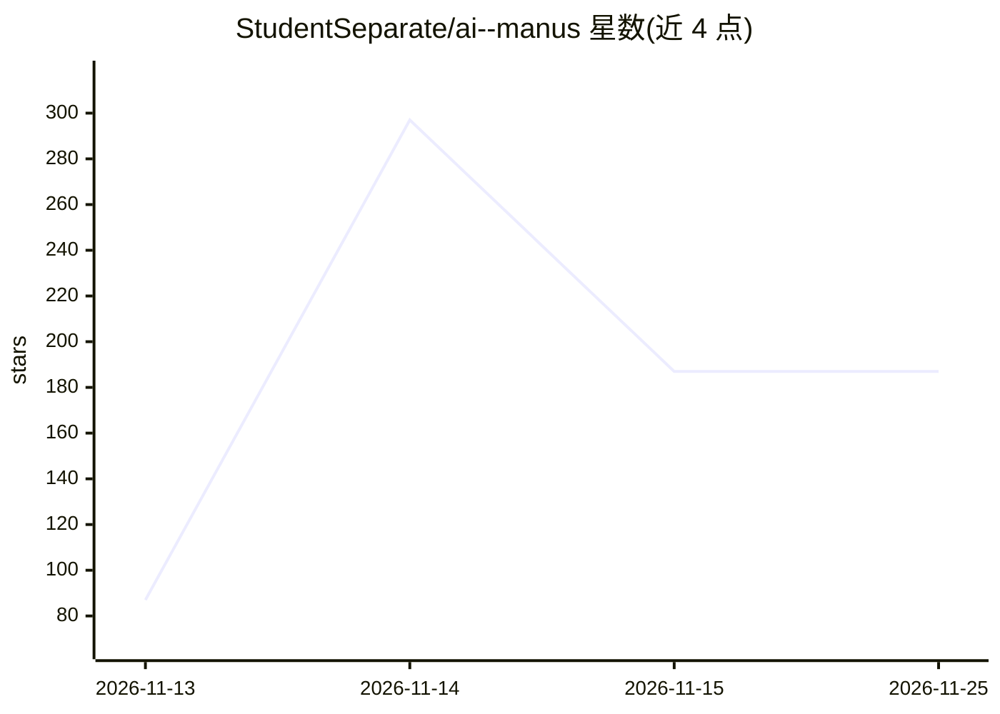

# StudentSeparate/ai--manus

⭐ 187 · Apache-2.0 · 推送 2026-11-15 · [GitHub](https://github.com/StudentSeparate/ai--manus) · 个人维护

**自主 AI Agent：代用户执行代码与控制浏览器完成多步任务**

面向个人用户的自主 AI Agent 产品介绍：以自然语言下达指令后，Agent 可自行编写并执行脚本、控制浏览器（导航网页、填写表单、抓取信息），并将脚本与浏览器操作串联完成多步任务，需少量监督。定位为家庭、学习与轻量办公场景的助手，非企业平台。README 声明最低 4 GB 内存、双核 CPU，推荐 8 GB 以上。全文为产品宣传式描述，未给出安装命令、代码仓库链接或技术实现细节。

## 筛选速览

| 维度 | 判定 | 备注 |
|---|---|---|
| AI 角色 | `ai-native` | 本体是模型或模型工具 |
| 许可风险 | `permissive` | Apache-2.0 |
| 部署形态 | `None` |  |
| 模型依赖 | — | README 未给出锁定关系 |
| 硬件要求 | — | 无带数字的原话,不猜 |
| 安装摩擦 | `low` | 无编译、无系统依赖或容器化 |
| 成熟度 | — | 结构信号不足 |

## 能力要点

- 自主编写并执行代码完成任务
- 浏览器控制：导航、填表、信息抓取
- 脚本与浏览器操作可在同一流程中衔接
- 跨会话保持任务模式的一致性

## 适用场景

- 让学生整理研究笔记、跑快速计算
- 让 Agent 从多个网页收集数据并汇总
- 把重复性的小型日常任务交给 Agent 后台处理

## 场景标签

`浏览器自动化` `编码 Agent` `AI 助手` · 领域:效率与自动化

## 证据(README 行号)

> L10: - **Autonomous Code Execution:** Manus AI agent runs code on its own to complete tasks, so you can focus on decisio
> L18: Manus is an autonomous AI agent designed to run code and control a browser on your behalf. Instead of acting like a

## 星数曲线

2026-11-13 87 → 2026-11-25 187（+100）

---
*卡片 v1 · prompt 1.4 · 生成 2026-11-17 · 置信度 mid · 依据 README sha `0f78ee3a5dd2` · [字段定义](../../DATASET.md)*
