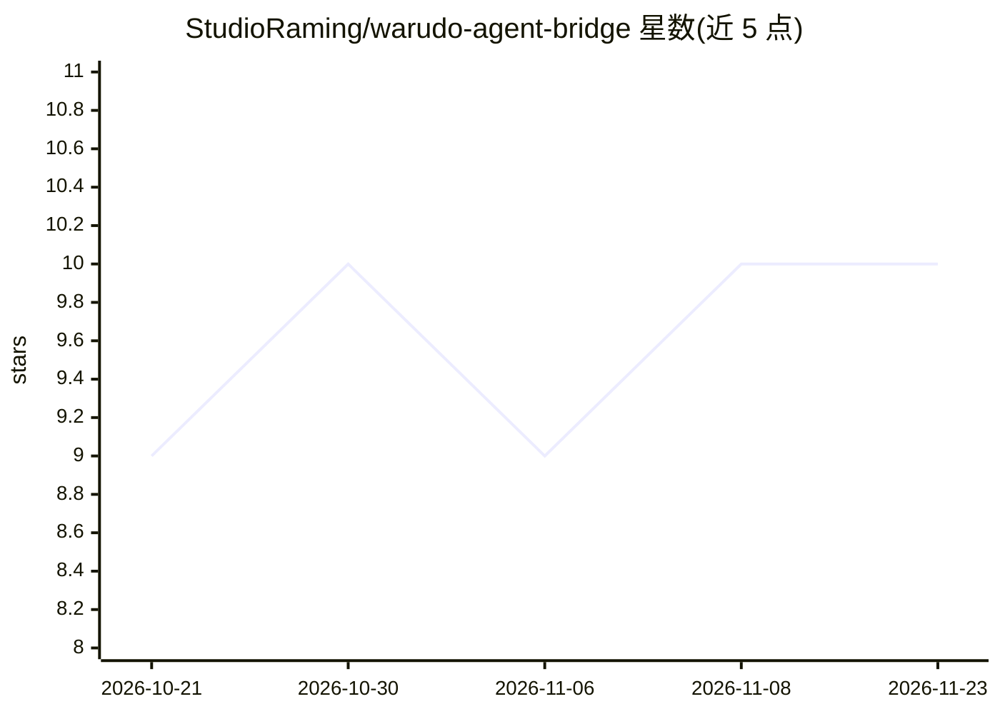

# StudioRaming/warudo-agent-bridge

⭐ 10 · C# · MIT · 推送 2026-10-21 · [GitHub](https://github.com/StudioRaming/warudo-agent-bridge) · [官网](https://www.npmjs.com/package/@studioraming/warudo-agent-bridge) · 个人维护

**让 AI 通过 MCP 驱动 WARUDO 的 86 工具桥接器**

为 WARUDO（Windows 程序）提供的 MCP server 与 CLI：安装后 AI 应用获得 86 个工具，可读取与操作运行中的 WARUDO 场景、资产、角色姿势与 IK、表情、蓝图、相机与截图，覆盖摆姿势、换表情、多角度拍照、场景快照与恢复、保存 Unity .anim 等操作。以 WARUDO Playground 脚本运行，数据仅经本机文件传递，不开网络端口；AI 应用与 WARUDO 需在同一台 PC。Windows 10/11 + Node.js 20+，PowerShell 一行命令安装，自动注册检测到的 AI 应用。

## 筛选速览

| 维度 | 判定 | 备注 |
|---|---|---|
| AI 角色 | `ai-ecosystem` | LLM/agent 周边工具 |
| 许可风险 | `permissive` | MIT |
| 部署形态 | `desktop` | 安装包/桌面程序 |
| 模型依赖 | — | README 未给出锁定关系 |
| 硬件要求 | — | 无带数字的原话,不猜 |
| 安装摩擦 | `low` | 无编译、无系统依赖或容器化 |
| 成熟度 | — | 结构信号不足 |

## 能力要点

- 提供 86 个 MCP 工具控制 WARUDO 的场景、姿势、表情、相机与截图
- 支持 Claude Desktop、Claude Code、Codex、ChatGPT Desktop、Cursor 等 AI 应用连接
- 安装器自动检测本机 AI 应用并注册连接，配置改动先备份
- 经本机文件传递数据，不开放网络端口

## 适用场景

- 用自然语言让 AI 操作 VTuber 场景摆姿势、换表情、多角度出图
- 拍摄前用 AI 检查姿势是否有脚陷地面等问题
- 让 AI 代为检查 WARUDO 日志与蓝图节点、保存场景与快照回滚

## 场景标签

 · 领域:AI 生态/工具桥接

## 证据(README 行号)

> L24: **MCP** (Model Context Protocol) is a **common spec for giving tools to AI**. Think of USB. The spec is the same ev
> L26: **WARUDO Agent Bridge** is a set of MCP tools for WARUDO. Once installed, the AI gets 86 tools: "move camera", "cha

## 星数曲线

2026-10-21 9 → 2026-11-23 10（+1）

---
*卡片 v1 · prompt 1.4 · 生成 2026-11-20 · 置信度 mid · 依据 README sha `3b2c4d1502e7` · [字段定义](../../DATASET.md)*
