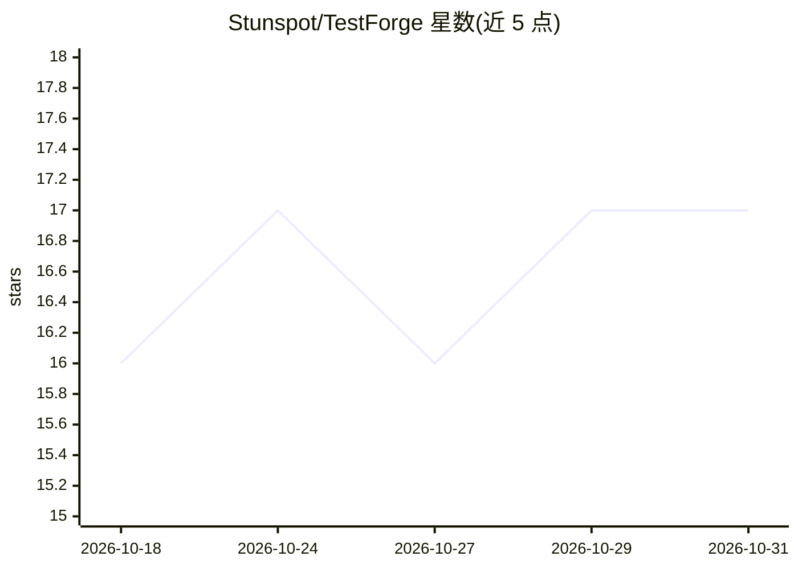

# Stunspot/TestForge

⭐ 17 · Python · NOASSERTION · 推送 2026-10-12 · [GitHub](https://github.com/Stunspot/TestForge) · [官网](https://stunspot.github.io/TestForge/) · 个人维护

**给本地编码 Agent 的风险驱动软件验证技能与行为评测工作台**

由两个 Agent SKILL（software-verification 与 verification-reviewer）组成的验证系统：对冻结的发布候选做影响重建、故障风险排序、测试设计与可追溯发布判定（READY/NOT_READY 等五态），再由独立评审技能质疑证据链。附带的 augment-evals 测试床可运行隔离行为评测，支持本地 Ollama 与 Codex CLI 适配器，并保存已评审基线做回归检测。通过 Codex 插件市场安装或下载 ZIP 挂载到各 Agent 宿主；确定性工具需 Python 3.10+，无强制第三方依赖。声明自身为咨询性验证机制，不证明无缺陷或不合规。

## 筛选速览

| 维度 | 判定 | 备注 |
|---|---|---|
| AI 角色 | `ai-ecosystem` | LLM/agent 周边工具 |
| 许可风险 | `permissive` | NOASSERTION |
| 部署形态 | `library` | 以包/库形式分发 |
| 模型依赖 | local-ok | 支持本地模型 |
| 硬件要求 | — | 无带数字的原话,不猜 |
| 安装摩擦 | `low` | 无编译、无系统依赖或容器化 |
| 成熟度 | — | 结构信号不足 |

## 能力要点

- 两个 SKILL：风险驱动验证 + 独立怀疑式评审
- 五态发布判定与可复现证据链
- 隔离行为评测测试床，支持 Ollama/Codex CLI 适配器
- 已评审基线提升与回归门禁

## 适用场景

- 让本地编码 Agent 对冻结候选给出证据支撑的发布判定
- 对其他 Agent 技能运行隔离行为评测并跟踪回归
- 以独立评审技能质疑验证结论的完整性

## 场景标签

`模型评测` · 领域:评测与运维

## 证据(README 行号)

> L25: - `$software-verification` reconstructs impact, ranks failure risk, designs meaningful oracles, creates stack-compa
> L38: - Run and track behavioral evals for other Augments with Codex or local Ollama models.
> L52: - `tools/augment-evals/` - isolated Augment behavioral evaluation harness.

## 星数曲线

2026-10-18 16 → 2026-10-31 17（+1）

---
*卡片 v1 · prompt 1.4 · 生成 2026-10-29 · 置信度 mid · 依据 README sha `e2ffe56bf184` · [字段定义](../../DATASET.md)*
