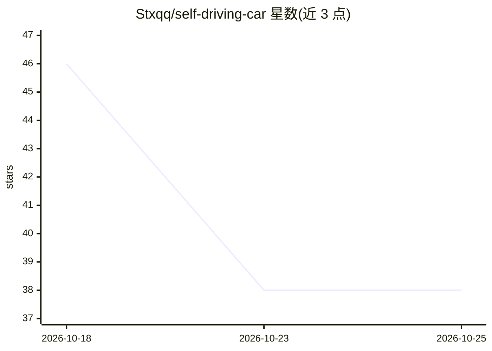

# Stxqq/self-driving-car

⭐ 38 · JavaScript · MIT · 推送 2026-10-01 · [GitHub](https://github.com/Stxqq/self-driving-car) · [官网](https://stxqq.github.io/self-driving-car/) · 个人维护

**纯 JS 神经网络+遗传算法进化出的高速自动驾驶仿真**

无依赖的原生 JavaScript 项目：19-12-8-2 tanh 神经网络通过遗传算法（精英保留、锦标赛选择、BLX 交叉、高斯变异）进化出在三条车道高速公路上跟车、刹车、变道超车的驾驶策略；网络输出油门与目标车道，手写规划器负责转向与 S 曲线变道。交通车遵循 IDM 模型并会对学习车做出反应。仿真逐位确定，同一随机种子结果可复现。提供浏览器内训练/驾驶页面、Node 命令行训练与评估脚本，适合对神经进化与自动驾驶仿真感兴趣的开发者。

## 筛选速览

| 维度 | 判定 | 备注 |
|---|---|---|
| AI 角色 | `ai-native` | 本体是模型或模型工具 |
| 许可风险 | `permissive` | MIT |
| 部署形态 | `None` |  |
| 模型依赖 | — | README 未给出锁定关系 |
| 硬件要求 | — | 无带数字的原话,不猜 |
| 安装摩擦 | `low` | 无编译、无系统依赖或容器化 |
| 成熟度 | — | 结构信号不足 |

## 能力要点

- 神经网络决策 + 手写规划器转向的两层驾驶架构
- 遗传算法进化：精英保留、锦标赛选择、BLX-0.25 交叉、变异率按 40 代半衰期衰减
- 仿真逐位确定，同种子同轨迹，测试套件回放 30 次留出运行核对到米
- 零依赖，约 1,300 行 ES 模块，浏览器与 Node 通用

## 适用场景

- 在浏览器中观看预训练网络驾驶并从随机权重开始进化
- 命令行无头训练与在未见道路上评估 brain
- 学习神经进化与驾驶仿真（车道扫描感知、IDM 交通、确定性物理）的实现

## 场景标签

 · 领域:机器学习/自动驾驶仿真

## 证据(README 行号)

> L3: A small neural network that taught itself, by evolution, to drive a curvy three-lane highway through traffic: hold t
> L17: Nobody shows the network how to drive. Each generation, a population of
> L60: - **Network.** 19 · 12 · 8 · 2, tanh, 362 weights. Two outputs: the pedal,

## 星数曲线

2026-10-18 46 → 2026-10-25 38（-8）

---
*卡片 v1 · prompt 1.4 · 生成 2026-10-25 · 置信度 high · 依据 README sha `715ea593cd0e` · [字段定义](../../DATASET.md)*
