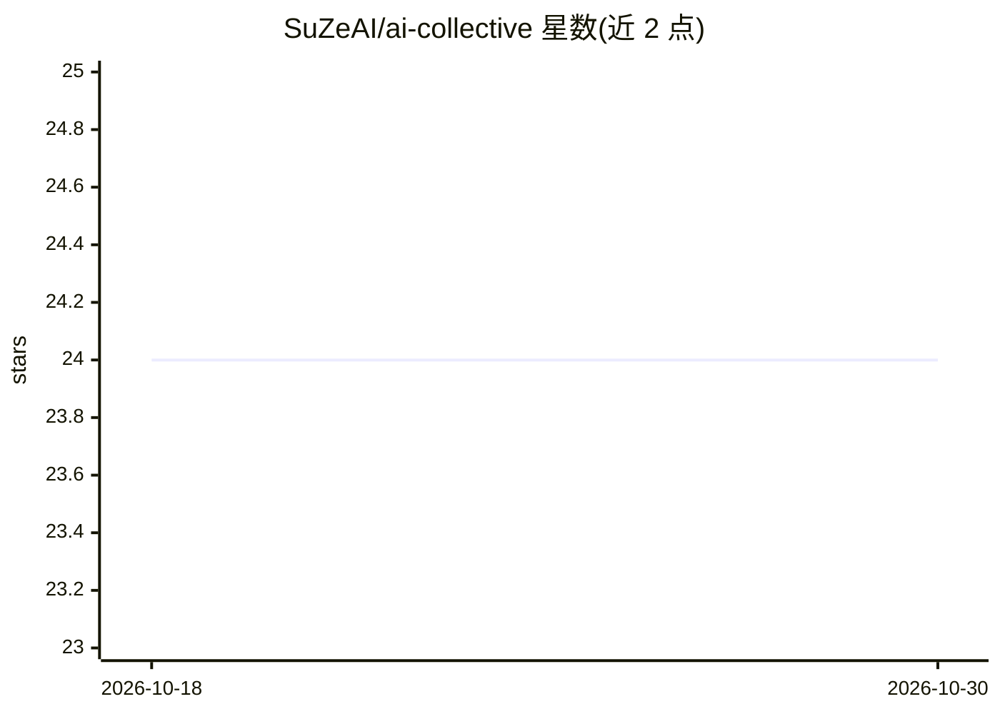

# SuZeAI/ai-collective

⭐ 24 · TypeScript · NOASSERTION · 推送 2026-10-06 · [GitHub](https://github.com/SuZeAI/ai-collective) · [官网](https://ai-collective-eight.vercel.app) · 组织维护

**构建与运行 AI 虚拟公司的多智能体协作平台**

提供后端（FastAPI）与 Web 前端（React），用户在聊天中描述一家公司，平台的 AI Office Designer 生成部门、员工与技能，员工各绑模型与工具，按六种拓扑（Sequential/Ring/Mesh/Supervisor/Tree/自定义 LangGraph DAG）协作执行任务。运行过程通过 SSE 流式输出并支持中途人工干预，持久化为知识图谱记忆。LLM 可换（Gemini/OpenAI/Claude/OpenRouter），存储支持 JSON 或 MongoDB，可从单机扩展到 RabbitMQ/Redis/Kubernetes。本地运行需 Node 18+、Python 3.11+ 与 uv，或 Docker 24+ 一键部署。

## 筛选速览

| 维度 | 判定 | 备注 |
|---|---|---|
| AI 角色 | `ai-ecosystem` | LLM/agent 周边工具 |
| 许可风险 | `none` | NOASSERTION |
| 部署形态 | `self-host` | docker 或自建部署 |
| 模型依赖 | locked-api |  |
| 硬件要求 | — | 无带数字的原话,不猜 |
| 安装摩擦 | `low` | 无编译、无系统依赖或容器化 |
| 成熟度 | — | 结构信号不足 |

## 能力要点

- 六种员工编排拓扑（含自定义 LangGraph DAG）
- 50+ 内置工具包可绑定到任意员工，支持并行子代理
- SSE 逐轮流式输出与运行中人工干预
- 多 LLM 支持：Gemini/OpenAI/Claude/OpenRouter 运行时可切换

## 适用场景

- 搭建由 AI 员工组成的软件初创或营销机构并运营多个公司
- 研究/内容等需要多角色分工协作的任务流水线
- 需要中途人工介入与知识图谱记忆的多智能体工作流

## 场景标签

`多智能体` `Agent 框架` · 领域:Agent 开发

## 证据(README 行号)

> L18: AI – Collective is a backend and web application for building and running **companies** — virtual
> L59: six topology modes — rather than a single LLM call. The platform is LLM-agnostic, supports both
> L95: - **Orchestration** — LangGraph 0.2 state machines with six topology modes

## 星数曲线

2026-10-18 24 → 2026-10-30 24（+0）

---
*卡片 v1 · prompt 1.4 · 生成 2026-10-27 · 置信度 high · 依据 README sha `dc486acb9221` · [字段定义](../../DATASET.md)*
