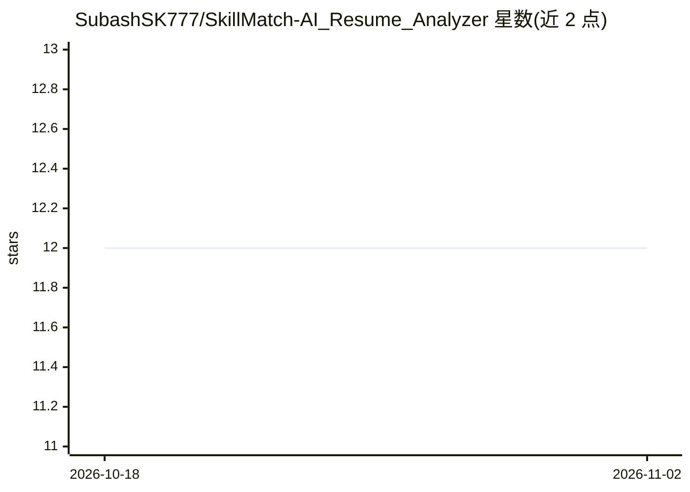

# SubashSK777/SkillMatch-AI_Resume_Analyzer

⭐ 12 · Jupyter Notebook · 推送 2026-03-21 · [GitHub](https://github.com/SubashSK777/SkillMatch-AI_Resume_Analyzer) · 个人维护

**解析简历 PDF 并生成评价与改进建议的 AI 应用**

SkillMatch AI 是一个简历分析应用：读取用户上传的 PDF 简历，将二进制数据解析为文本，进行语义切分与实体识别，再结合 LLM（OpenAI/Gemini，据仓库标签）生成摘要、优势与弱点评估及个性化改进建议。前端用 React 与 TailwindCSS，后端用 Python/Jupyter Notebook。README 以流程图描述解析管线，但未给出安装运行命令，贡献流程为 fork/commit/PR。

## 筛选速览

| 维度 | 判定 | 备注 |
|---|---|---|
| AI 角色 | `ai-native` | 本体是模型或模型工具 |
| 许可风险 | `none` | — |
| 部署形态 | `None` |  |
| 模型依赖 | — | README 未给出锁定关系 |
| 硬件要求 | — | 无带数字的原话,不猜 |
| 安装摩擦 | `low` | 无编译、无系统依赖或容器化 |
| 成熟度 | — | 结构信号不足 |

## 能力要点

- PDF 上传后解析为文本再做语义切分与实体识别
- 生成简历摘要、优劣势评估与改进建议
- React + TailwindCSS 前端，Python 后端

## 适用场景

- 上传简历获得优势与弱点分析
- 获取针对简历的个性化改进建议
- 了解自身技能与行业技术趋势的对照

## 场景标签

`RAG` `文档解析` · 领域:知识与检索

## 证据(README 行号)

> L11: SkillMatch AI is a **High-Dimension NLP Extraction Engine** designed to decode the latent technical DNA of professi
> L16: 1. **Bitstream Ingestion**: Raw binary PDF data is parsed into normalized text buffers.

## 星数曲线

2026-10-18 12 → 2026-11-02 12（+0）

---
*卡片 v1 · prompt 1.4 · 生成 2026-11-01 · 置信度 mid · 依据 README sha `3221f05f77d1` · [字段定义](../../DATASET.md)*
