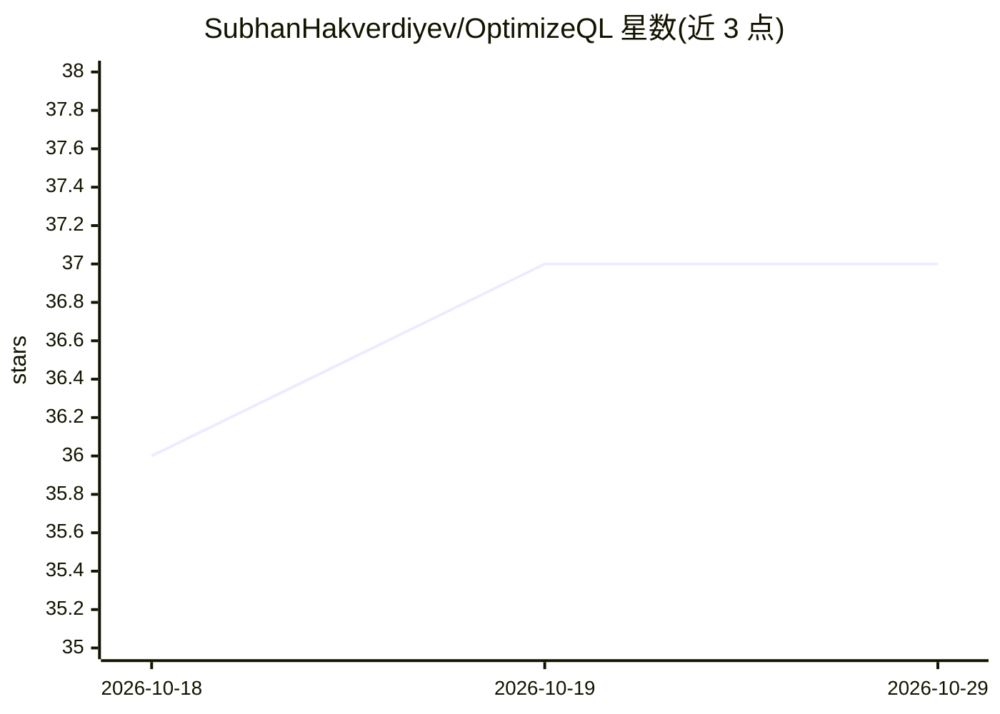

# SubhanHakverdiyev/OptimizeQL

⭐ 37 · TypeScript · MIT · 推送 2026-03-28 · [GitHub](https://github.com/SubhanHakverdiyev/OptimizeQL) · [官网](https://optimizeql.com) · 个人维护

**AI 驱动的 SQL 查询优化器：分析 EXPLAIN 计划并给出索引与改写建议**

面向开发者的 Web 应用：连接 PostgreSQL 或 MySQL 数据库运行 EXPLAIN ANALYZE，自动收集 schema、索引与列统计信息，交由多厂商 LLM（Anthropic/OpenAI/Gemini/DeepSeek/OpenRouter 等）分析，返回 CREATE INDEX 语句、查询改写、物化视图与配置调优建议及预估影响等级。支持 HypoPG 虚拟索引模拟（可选，不创建真实索引）、双查询对比、无连接模式、Monaco 编辑器与仪表盘。后端 FastAPI + SQLite，前端 Next.js 16，docker compose 一键部署，凭据以 Fernet 加密存储。

## 筛选速览

| 维度 | 判定 | 备注 |
|---|---|---|
| AI 角色 | `ai-native` | 本体是模型或模型工具 |
| 许可风险 | `permissive` | MIT |
| 部署形态 | `self-host` | docker 或自建部署 |
| 模型依赖 | locked-api |  |
| 硬件要求 | — | 无带数字的原话,不猜 |
| 安装摩擦 | `low` | 无编译、无系统依赖或容器化 |
| 成熟度 | — | 结构信号不足 |

## 能力要点

- 连接 PostgreSQL/MySQL 运行 EXPLAIN ANALYZE 并自动收集统计信息
- 多厂商 LLM 分析：Anthropic/OpenAI/Gemini/DeepSeek/Qwen/Kimi/OpenRouter 等
- 基于 HypoPG 的虚拟索引模拟与前后执行计划对比
- 无连接模式下可直接粘贴 SQL 获取建议；凭据 Fernet 加密存储

## 适用场景

- 分析慢查询的执行计划并获取索引与改写建议
- 用 HypoPG 模拟索引效果而不创建真实索引
- 对比两个 SQL 写法的执行性能

## 场景标签

`数据分析` · 领域:效率与自动化

## 证据(README 行号)

> L10: AI-powered SQL query optimizer that analyzes EXPLAIN plans and suggests indexes, rewrites, and configuration change
> L23: - 🤖 **Multi-provider LLM analysis** — supports Anthropic, OpenAI, Gemini, DeepSeek, xAI, Qwen, Meta Llama, Kimi, an

## 星数曲线

2026-10-18 36 → 2026-10-29 37（+1）

---
*卡片 v1 · prompt 1.4 · 生成 2026-10-25 · 置信度 mid · 依据 README sha `0efafebaa72a` · [字段定义](../../DATASET.md)*
