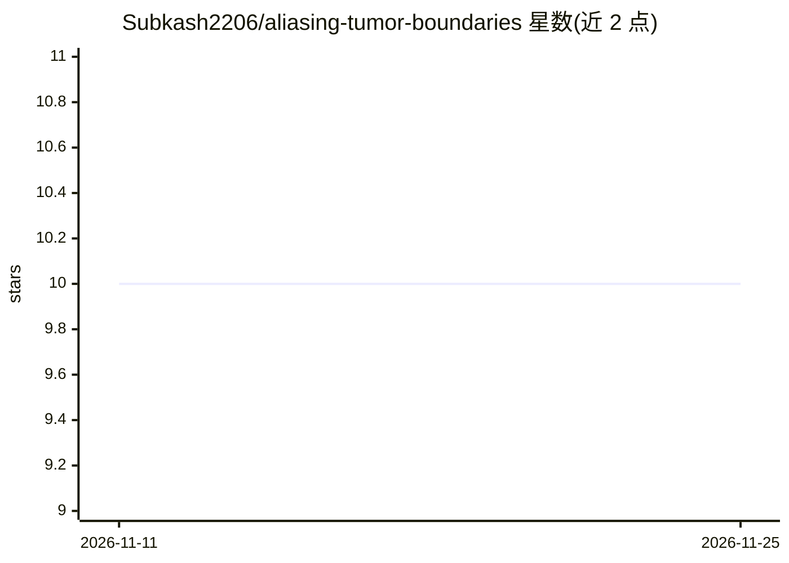

# Subkash2206/aliasing-tumor-boundaries

⭐ 10 · Python · MIT · 推送 2026-05-11 · [GitHub](https://github.com/Subkash2206/aliasing-tumor-boundaries) · [官网](https://openreview.net/forum?id=F7RaWxyKXD) · 个人维护

**MIDL 2026 论文代码：研究 3D 分割中抗混叠与边界精度的权衡**

论文《Investigating the structural cost of anti-aliasing in 3D volumetric medical segmentation》的官方实现，面向医学影像研究场景。基于 MONAI 在 BraTS 2021 数据上以 SegResNet 为基础模型，通过递归改写网络图中所有步幅为 2 的下采样卷积为 3D BlurPool 低通滤波，比较干预前后的混叠与边界表现；提出 Alias Violation Ratio（基于 3D FFT）与 Boundary F1（2mm 边缘壳）两个度量，在 251 例验证体积上评估，报告 Cohen's d 等统计量。README 未给出安装与运行步骤。

## 筛选速览

| 维度 | 判定 | 备注 |
|---|---|---|
| AI 角色 | `ai-native` | 本体是模型或模型工具 |
| 许可风险 | `permissive` | MIT |
| 部署形态 | `library` | 以包/库形式分发 |
| 模型依赖 | — | README 未给出锁定关系 |
| 硬件要求 | `gpu-8g` | |
| 安装摩擦 | `low` | 无编译、无系统依赖或容器化 |
| 成熟度 | — | 结构信号不足 |

## 能力要点

- 将 2D BlurPool 抗混叠逻辑扩展为 3D 体素低通滤波并注入 SegResNet
- 基于 3D FFT 的 Alias Violation Ratio 混叠量化指标
- 基于形态学腐蚀与 2mm 边缘壳的 Boundary F1 边界精度度量
- 在 BraTS 2021 的 251 例验证体积上报告统计效应量

## 适用场景

- 复现论文中 BlurPool 对 3D 医学分割边界精度影响的实验
- 在自己的分割网络中测量混叠能量与边界 F1 的相关性
- 医学影像抗混叠架构设计的消融实验参考

## 场景标签

`科研工具` · 领域:学习与行业

## 证据(README 行号)

> L118: The entire system was completely reprogrammed away from canonical two-dimensional slice frameworks into a fully na
> L122: 3. **The Intervention**: A specialized discrete replacement algorithm loops recursively through the MONAI neural n
> L123: 4. **Evaluation**: Both architectures evaluated exactly 251 unseen clinical BraTS 2021 test volumes utilizing a co

## 星数曲线

2026-11-11 10 → 2026-11-25 10（+0）

---
*卡片 v1 · prompt 1.4 · 生成 2026-11-20 · 置信度 low · 依据 README sha `e12130c689bb` · [字段定义](../../DATASET.md)*
