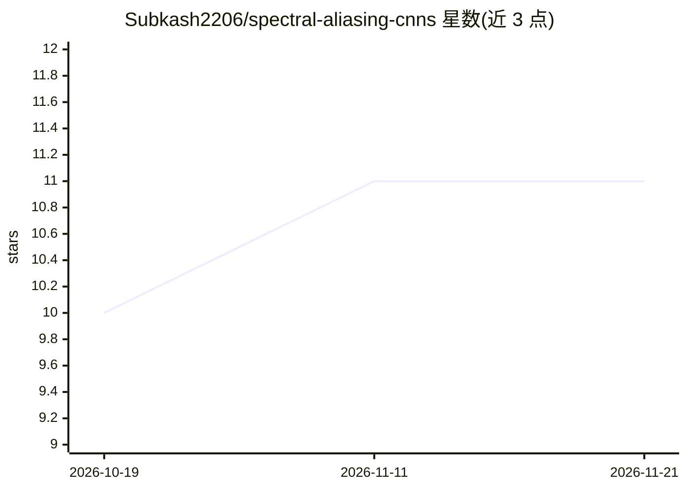

# Subkash2206/spectral-aliasing-cnns

⭐ 11 · Python · 推送 2026-05-11 · [GitHub](https://github.com/Subkash2206/spectral-aliasing-cnns) · 个人维护

**面向研究者量化 CNN 步进卷积频谱混叠的分析框架**

提供一条频谱分析流水线，对带步进下采样的 CNN（以 ResNet50 与 BlurPool 变体为对象）逐层计算两个指标：AVR（Alias Violation Ratio，度量特征图超出奈奎斯特截止频率的能量占比）与 SIS（Shift Instability Score，度量输入平移 1 像素下输出概率向量的变化）。在 1000 张 STL10 图像上报告 BlurPool 将 SIS 降低 39.8%、推理时间增加 18.9% 等实验结果，并给出钩子挂载点对应关系与频率扫描验证。面向机器学习研究者，用于复现实验或分析自有模型的频谱混叠与预测稳定性。

## 筛选速览

| 维度 | 判定 | 备注 |
|---|---|---|
| AI 角色 | `ai-ecosystem` | LLM/agent 周边工具 |
| 许可风险 | `none` | — |
| 部署形态 | `library` | 以包/库形式分发 |
| 模型依赖 | — | README 未给出锁定关系 |
| 硬件要求 | `gpu-8g` | |
| 安装摩擦 | `medium` | 含编译或系统依赖之一 |
| 成熟度 | — | 结构信号不足 |

## 能力要点

- 定义并实现 AVR 与 SIS 两个量化指标，附数学定义与实现
- 逐层钩子挂载，比较 ResNet50 与 BlurPool 的层间 AVR（含 t 检验）
- 频率扫描验证 AVR 在奈奎斯特边界 0.5 处阶跃响应
- 支持通过 get_imagefolder_loader() 使用 ImageNet 验证集

## 适用场景

- 测量自己训练的 CNN 各下采样层的频谱混叠程度
- 复现 ResNet50 与 BlurPool 的预测稳定性对比实验
- 研究输入平移下模型预测不一致性的成因

## 场景标签

`科研工具` · 领域:学习与行业

## 证据(README 行号)

> L62: To answer these questions we build a complete spectral analysis pipeline,
> L296: ## Reproducing Results
> L301: - CUDA-enabled GPU recommended (tested on RTX 4050 6GB VRAM)

## 星数曲线

2026-10-19 10 → 2026-11-21 11（+1）

---
*卡片 v1 · prompt 1.4 · 生成 2026-11-18 · 置信度 mid · 依据 README sha `0adc1408ee7a` · [字段定义](../../DATASET.md)*
