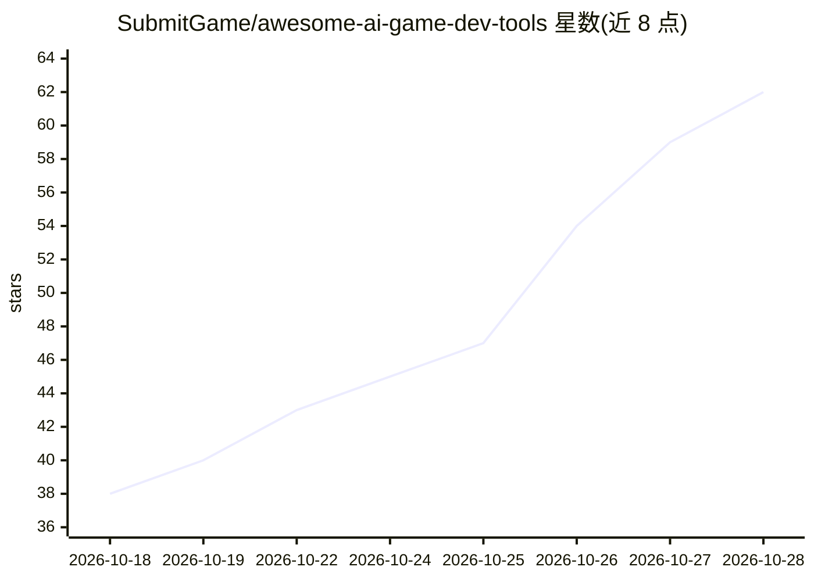

# SubmitGame/awesome-ai-game-dev-tools

⭐ 62 · Python · CC0-1.0 · 推送 2026-10-27 · [GitHub](https://github.com/SubmitGame/awesome-ai-game-dev-tools) · [官网](https://submitgame.github.io/awesome-ai-game-dev-tools/) · 组织维护

**开源 AI 游戏开发与逆向工具策展清单（150 条活跃工具）**

面向游戏开发者与 AI agent 用户的策展清单：收录 150 个活跃开源工具（100+ 星且一年内有提交），覆盖游戏反编译/重编译、agent 驱动 modding、游戏混搭、AI 资产重制、编码 agent 与 MCP 服务器等类别。星数经 GitHub API 每日刷新，数据存于 data/tools.json，提供带标签过滤的网站浏览，另附人工挑选的教程视频与趋势观察。

## 筛选速览

| 维度 | 判定 | 备注 |
|---|---|---|
| AI 角色 | `ai-knowledge` | 知识聚合/清单类 |
| 许可风险 | `viral` | CC0-1.0 |
| 部署形态 | `None` |  |
| 模型依赖 | — | README 未给出锁定关系 |
| 硬件要求 | — | 无带数字的原话,不猜 |
| 安装摩擦 | `low` | 无编译、无系统依赖或容器化 |
| 成熟度 | — | 结构信号不足 |

## 能力要点

- 150 个活跃工具条目，星数经 GitHub API 每日刷新
- 覆盖反编译/重编译、agent modding、混搭、AI 资产重制等类别
- 收录编码 agent 与 Unity/Godot/Unreal/Blender 的 MCP 桥接工具
- 附教程视频、指南与社区趋势观察

## 适用场景

- 寻找可用于游戏逆向与 modding 的 AI agent 工具
- 为游戏引擎选择合适的 MCP 服务器与编码 agent
- 查找 AI 贴图放大与资产重制工具

## 场景标签

`精选清单` · 领域:学习与行业

## 证据(README 行号)

> L5: > Open-source AI tools for making games, and for **decompiling, remixing and mashing up the games you already own**.
> L7: **150 active tools** · 61 inactive · updated 2026-10-24 · browse with tag filters on the **website** · data in `data
> L133: ## 2. Agents & MCP servers

## 星数曲线

2026-10-18 38 → 2026-10-28 62（+24）

---
*卡片 v1 · prompt 1.4 · 生成 2026-10-25 · 置信度 high · 依据 README sha `ef01a30c99b2` · [字段定义](../../DATASET.md)*
