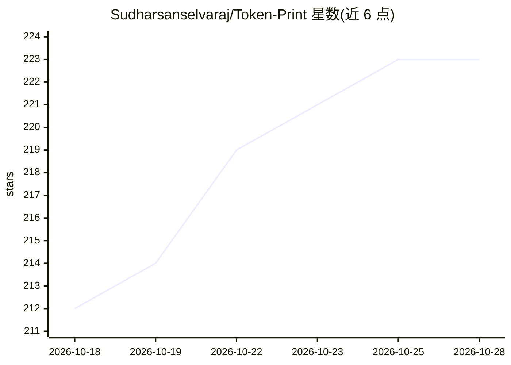

# Sudharsanselvaraj/Token-Print

⭐ 223 · TypeScript · MIT · 推送 2026-10-27 · [GitHub](https://github.com/Sudharsanselvaraj/Token-Print) · [官网](https://tokenprint.in/) · 个人维护

**Transformer 架构与推理过程的 3D 可视化调试器**

加载真实模型（默认 Qwen2.5-0.5B-Instruct）运行真实前向传播，在 3D 界面中检视注意力、RoPE、KV cache 与残差流；提供断点、观察表达式、激活消融前后对比、logit lens、trace 录制回放与分支等调试功能。支持 Python 后端、量化 GGUF、浏览器 WebGPU+ONNX 运行 GPT-2 三种方式。面向研究与学习 transformer 内部机制的用户；限制：llama.cpp 路径下无逐层激活、浏览器推理仅覆盖 GPT-2 桌面端贪婪解码。

## 筛选速览

| 维度 | 判定 | 备注 |
|---|---|---|
| AI 角色 | `ai-ecosystem` | LLM/agent 周边工具 |
| 许可风险 | `permissive` | MIT |
| 部署形态 | `library` | 以包/库形式分发 |
| 模型依赖 | local-ok | 支持本地模型 |
| 硬件要求 | — | 无带数字的原话,不猜 |
| 安装摩擦 | `medium` | 含编译或系统依赖之一 |
| 成熟度 | — | 结构信号不足 |

## 能力要点

- 真实数值可视化，CI 禁止假数据进入应用，数值带 REAL/DERIVED/CONCEPTUAL/SIMULATION 标签
- 断点、激活消融 diff、logit lens、induction-head 实验与 trace 录制回放分支
- 三种运行方式：Python 后端 / 量化 GGUF / 浏览器 WebGPU+ONNX 运行 GPT-2
- 支持 Qwen2.5 实时运行，Llama、Gemma、Mistral、DeepSeek、Phi 等以 GGUF 加载

## 适用场景

- 学习与教学 transformer 内部机制（注意力、RoPE、KV cache）
- 调试与消融实验：观察激活变化对输出的影响
- 离线回放录制 trace 演示模型推理过程

## 场景标签

`LLM 可观测性` · 领域:评测与运维

## 证据(README 行号)

> L5:  TokenPrint is a 3D visual debugger for transformers. Load a real model, run a real forward pass,
> L60: - **A debugger, not just a viewer.** Breakpoints, watch expressions, activation ablation with before/after diff, lo

## 星数曲线

2026-10-18 212 → 2026-10-28 223（+11）

---
*卡片 v1 · prompt 1.4 · 生成 2026-10-22 · 置信度 high · 依据 README sha `a00e85d36644` · [字段定义](../../DATASET.md)*
