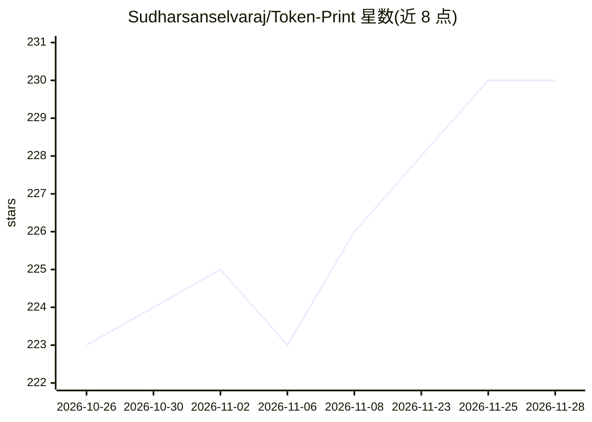

# Sudharsanselvaraj/Token-Print

⭐ 230 · TypeScript · MIT · 推送 2026-11-27 · [GitHub](https://github.com/Sudharsanselvaraj/Token-Print) · [官网](https://tokenprint.in/) · 个人维护

**开发者的 Transformer 3D 可视化调试器：实时检查注意力与推理过程**

开源 3D 可视化调试工具：加载真实模型执行前向传播，实时呈现注意力、RoPE、KV cache 与残差流，支持断点、激活消融、logit lens、trace 录制回放等调试功能。提供三种运行方式：PyTorch 后端（CUDA/MPS/CPU）、llama.cpp 的量化 GGUF 推理、浏览器内 GPT-2 WebGPU 推理。数据标记 REAL/DERIVED/CONCEPTUAL/SIMULATION 并有 CI 校验与独立验证脚本。支持 Qwen、Llama、Gemma、Mistral、DeepSeek、Phi 等模型家族，可托管于 Hugging Face Spaces + ZeroGPU。

## 筛选速览

| 维度 | 判定 | 备注 |
|---|---|---|
| AI 角色 | `ai-native` | 本体是模型或模型工具 |
| 许可风险 | `permissive` | MIT |
| 部署形态 | `library` | 以包/库形式分发 |
| 模型依赖 | local-ok | 支持本地模型 |
| 硬件要求 | — | 无带数字的原话,不猜 |
| 安装摩擦 | `medium` | 含编译或系统依赖之一 |
| 成熟度 | — | 结构信号不足 |

## 能力要点

- 断点、消融、activation patching、logit lens、induction-head 实验室等调试机制
- GGUF 文件在客户端解析，数据不上传
- 每个数值可追溯到 named_parameters() 或真实前向传播，并有 CI 校验与验证脚本
- 三种运行模式：PyTorch 后端 / llama.cpp 量化 GGUF / 浏览器 WebGPU

## 适用场景

- 调试和理解模型内部注意力与激活行为
- 向学生逐步演示 tokenizer 到 softmax 的推理流程
- 检查量化 GGUF 权重的逐 token 概率与 KV cache 开销
- 在无 GPU 环境下回放录制的推理 trace

## 场景标签

 · 领域:开发工具/模型可视化调试

## 证据(README 行号)

> L4:  An open-source 3D visual debugger for transformers: run a real forward pass and inspect attention, RoPE, the KV cac
> L35: Architecture diagrams show you a transformer. TokenPrint runs one and lets you look inside. Load a real model, run 
> L38: - **A debugger, not a viewer.** Breakpoints, watch expressions, activation ablation with before/after diff, logit l

## 星数曲线

2026-10-26 223 → 2026-11-28 230（+7）

---
*卡片 v1 · prompt 1.4 · 生成 2026-11-25 · 置信度 mid · 依据 README sha `1d4f264754ab` · [字段定义](../../DATASET.md)*
