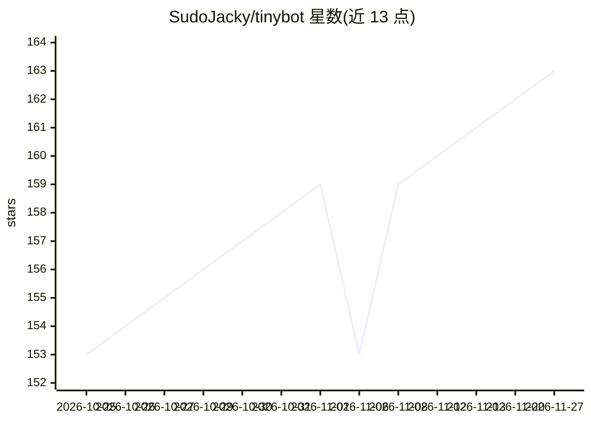

# SudoJacky/tinybot

⭐ 163 · Rust · MIT · 推送 2026-10-28 · [GitHub](https://github.com/SudoJacky/tinybot) · [官网](https://sudojacky.github.io/tinybot/) · 个人维护 · 中文 README

**基于 LLM 与原生工具系统的轻量个人 AI 助手**

基于 Node.js、Rust 与 Tauri 构建的桌面端个人 AI 助手，由大语言模型驱动并内置原生工具系统。支持创建、编辑和运行可复用的 Agent Graph，对话中可将已保存的 Graph 作为工具调用并取其输出继续任务；Windows 提供动画桌面宠物，支持拖拽文本、图片、文件进入快速对话；自 v0.2.3 起支持 Agent Plugins 1.0.0 标准，并内置 create-agent-plugin 辅助工具可将已有 Skill 或 MCP 配置迁移为插件。还可生成自定义图表。README 声明项目因资源不足已逐渐停滞，帮助手册目前仅有中文版。

## 筛选速览

| 维度 | 判定 | 备注 |
|---|---|---|
| AI 角色 | `ai-native` | 本体是模型或模型工具 |
| 许可风险 | `permissive` | MIT |
| 部署形态 | `None` |  |
| 模型依赖 | — | README 未给出锁定关系 |
| 硬件要求 | — | 无带数字的原话,不猜 |
| 安装摩擦 | `low` | 无编译、无系统依赖或容器化 |
| 成熟度 | — | 结构信号不足 |

## 能力要点

- 支持创建、编辑、运行可复用 Agent Graph，并可在对话中作为工具调用
- 遵循 Agent Plugins 1.0.0 标准，内置 Skill/MCP 配置迁移工具
- Windows 桌面宠物支持拖拽文本/图片/文件快速对话
- 可在对话中生成自定义图表

## 适用场景

- 在桌面端通过 LLM 助手执行任务并调用工具
- 将已有 Skill 或 MCP 配置迁移为 Agent 插件
- 通过拖拽文件到桌面宠物快速发起对话

## 场景标签

`AI 助手` · 领域:对话与助手

## 证据(README 行号)

> L19: A lightweight personal AI assistant powered by Large Language Models and a native tool system.
> L32: Tinybot supports creating, editing, and running reusable Agent Graphs. In a conversation with a selected workspace,

## 星数曲线

2026-10-25 153 → 2026-11-27 163（+10）

---
*卡片 v1 · prompt 1.4 · 生成 2026-11-27 · 置信度 high · 依据 README sha `2156c30ac5d0` · [字段定义](../../DATASET.md)*
