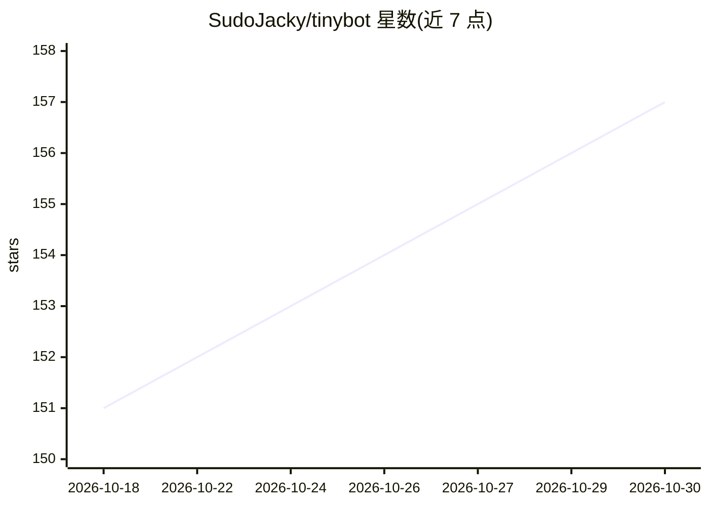

# SudoJacky/tinybot

⭐ 157 · Rust · MIT · 推送 2026-10-28 · [GitHub](https://github.com/SudoJacky/tinybot) · [官网](https://sudojacky.github.io/tinybot/) · 个人维护 · 中文 README

**桌面端个人 AI 助手：对话+原生工具+插件+Agent Graph**

基于 Rust/Tauri 与 Node.js 的桌面个人 AI 助手应用，由 LLM 驱动对话并提供原生工具系统。核心能力包括：工作区管理、可创建编辑运行的 Agent Graph（可被 Chat Agent 作为工具调用）、符合 Agent Plugins 1.0.0 标准的插件系统（内置 create-agent-plugin 辅助工具，可将现有 Skill 或 MCP 配置迁移转换）、Windows 动画桌面宠物（拖拽文本/图片/文件快速对话，图像理解需模型支持）。通过 GitHub Releases 下载安装包，帮助文档为中文。

## 筛选速览

| 维度 | 判定 | 备注 |
|---|---|---|
| AI 角色 | `ai-native` | 本体是模型或模型工具 |
| 许可风险 | `permissive` | MIT |
| 部署形态 | `None` |  |
| 模型依赖 | — | README 未给出锁定关系 |
| 硬件要求 | — | 无带数字的原话,不猜 |
| 安装摩擦 | `low` | 无编译、无系统依赖或容器化 |
| 成熟度 | — | 结构信号不足 |

## 能力要点

- Agent Graph 可作为工具被 Chat Agent 调用并接续任务
- 支持 Agent Plugins 1.0.0 标准，内置 Skill/MCP 配置迁移
- Windows 桌面宠物：拖拽文本/图片/文件快速发起对话
- 工作区与插件管理（Tools & Plugins）

## 适用场景

- 在桌面端与 LLM 对话并调用原生工具完成日常任务
- 把现有 Skill 或 MCP 配置迁移为插件继续使用
- 搭建可复用的工作流 Graph 并在对话中调用

## 场景标签

`AI 助手` · 领域:对话与助手

## 证据(README 行号)

> L19: A lightweight personal AI assistant powered by Large Language Models and a native tool system.
> L32: Tinybot supports creating, editing, and running reusable Agent Graphs. In a conversation with a selected workspace,

## 星数曲线

2026-10-18 151 → 2026-10-30 157（+6）

---
*卡片 v1 · prompt 1.4 · 生成 2026-10-22 · 置信度 mid · 依据 README sha `f41a3818377a` · [字段定义](../../DATASET.md)*
