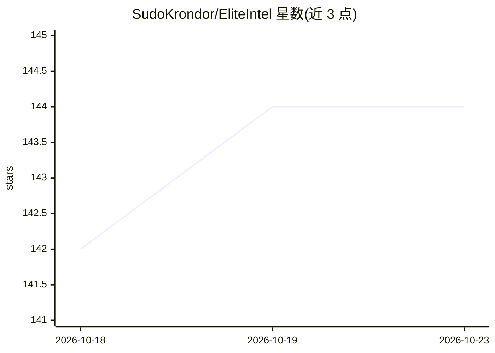

# SudoKrondor/EliteIntel

⭐ 144 · Java · CC0-1.0 · 推送 2026-10-22 · [GitHub](https://github.com/SudoKrondor/EliteIntel) · 个人维护

**Elite Dangerous 游戏的 LLM 助手与数据分析工具**

面向 Elite Dangerous 玩家的桌面辅助应用：集成 LLM 作为游戏侧助手（side-kick），提供数据分析与问答等 QoL 功能，V1.1 支持多语言。LLM 后端两种方式：本地 LLM（免费离线，需 GPU 硬件并参照官方文档安装）或云端 LLM 服务；应用本身可 100% 离线运行。提供 Linux 与 Windows 安装器，采用 CC0 1.0 许可，社区通过 GitHub Issues 与 Matrix 联系。

## 筛选速览

| 维度 | 判定 | 备注 |
|---|---|---|
| AI 角色 | `ai-enhanced` | 去掉 AI 部分产品仍成立 |
| 许可风险 | `viral` | CC0-1.0 |
| 部署形态 | `None` |  |
| 模型依赖 | — | README 未给出锁定关系 |
| 硬件要求 | — | 无带数字的原话,不猜 |
| 安装摩擦 | `low` | 无编译、无系统依赖或容器化 |
| 成熟度 | — | 结构信号不足 |

## 能力要点

- Linux 与 Windows 安装器，可 100% 离线运行
- 支持本地 LLM（免费离线，需 GPU）或云端 LLM 两种接入方式
- V1.1 支持多语言

## 适用场景

- 游玩 Elite Dangerous 时用 LLM 助手查询信息
- 离线环境下使用本地 LLM 获得游戏辅助功能

## 场景标签

`AI 助手` `数据分析` · 领域:效率与自动化

## 证据(README 行号)

> L3: # Elite Intel - V1.1 (Multi lingual)
> L7: Can be run 100% off-line or with various cloud services

## 星数曲线

2026-10-18 142 → 2026-10-23 144（+2）

---
*卡片 v1 · prompt 1.4 · 生成 2026-10-22 · 置信度 mid · 依据 README sha `c576a3c9e61f` · [字段定义](../../DATASET.md)*
