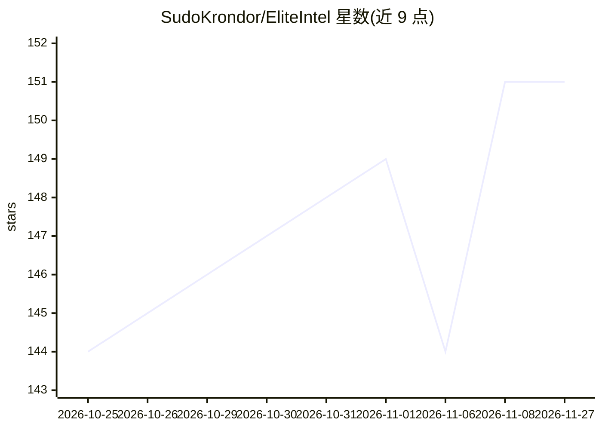

# SudoKrondor/EliteIntel

⭐ 151 · Java · MIT · 推送 2026-11-26 · [GitHub](https://github.com/SudoKrondor/EliteIntel) · 组织维护

**给 Elite Dangerous 玩家的 AI 语音副驾驶与数据分析助手**

面向 Elite Dangerous 玩家的语音助手：用户以自然语言对话，由 AI 解析并执行飞船系统操作、航线规划、贸易、探索、外星生物学与殖民任务，并基于游戏日志及 Spansh/EDSM/EDDN 实时数据输出配置与信号分析。语音识别用 Parakeet，语音用 Supertonic-3，语言模型必须配置：本地 LM Studio（需 GPU）或云服务 API key。支持 Windows 与 Linux，附 BindForge 按键管理、HUD 覆盖层、音乐播放与多语言。

## 筛选速览

| 维度 | 判定 | 备注 |
|---|---|---|
| AI 角色 | `ai-native` | 本体是模型或模型工具 |
| 许可风险 | `permissive` | MIT |
| 部署形态 | `None` |  |
| 模型依赖 | — | README 未给出锁定关系 |
| 硬件要求 | — | 无带数字的原话,不猜 |
| 安装摩擦 | `low` | 无编译、无系统依赖或容器化 |
| 成熟度 | — | 结构信号不足 |

## 能力要点

- 自然语音输入，无需记忆命令或语法，AI 解析意图并执行
- 本地离线管线：Parakeet 语音识别 + LM Studio 本地 LLM + Supertonic-3 语音
- 基于游戏日志与 Spansh/EDSM/EDDN 实时数据做载荷与信号分析
- BindForge 按键绑定编辑与备份（键盘/鼠标/HOTAS/踏板）

## 适用场景

- 飞行中用语音操控飞船系统并规划航线
- 分析当前舰船配置与星系信号
- 离线运行本地模型，每艘船配不同语音与人格

## 场景标签

`语音 Agent` `数据分析` · 领域:效率与自动化

## 证据(README 行号)

> L3: **AI voice assistant for Elite Dangerous.** Speak naturally, fly better.
> L13: The whole pipeline can run offline on your own PC: Parakeet speech recognition, a local language model in LM Studio

## 星数曲线

2026-10-25 144 → 2026-11-27 151（+7）

---
*卡片 v1 · prompt 1.4 · 生成 2026-11-27 · 置信度 high · 依据 README sha `323b51cdf9db` · [字段定义](../../DATASET.md)*
