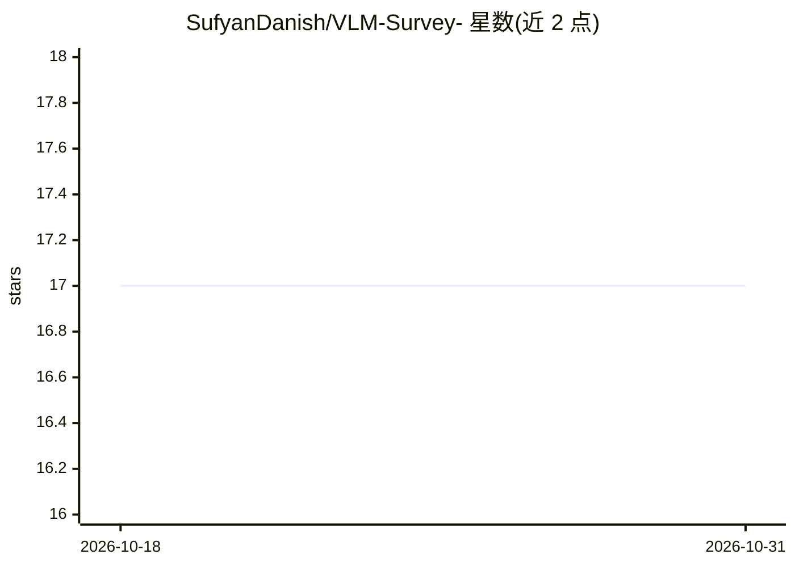

# SufyanDanish/VLM-Survey-

⭐ 17 · 推送 2026-03-27 · [GitHub](https://github.com/SufyanDanish/VLM-Survey-) · [官网](https://www.sciencedirect.com/science/article/pii/S1566253525006955) · 个人维护

**视觉-语言模型综述论文配套资源库**

发表于 Information Fusion 的 VLM 综述论文（Danish 等，2025）配套 GitHub 仓库，系统回顾 2018–2025 年间 115 篇论文，覆盖微调策略、提示工程、预训练模型、适配器模块与基准数据集五类组件，给出分类体系与跨基准的比较结论，并讨论参数高效适配方法及可扩展性、泛化、偏见等开放问题。仓库以 README 表格形式收录相关论文与代码链接，通过 PR 接受社区补充，供研究人员与从业者查阅。

## 筛选速览

| 维度 | 判定 | 备注 |
|---|---|---|
| AI 角色 | `ai-knowledge` | 知识聚合/清单类 |
| 许可风险 | `none` | — |
| 部署形态 | `None` |  |
| 模型依赖 | — | README 未给出锁定关系 |
| 硬件要求 | — | 无带数字的原话,不猜 |
| 安装摩擦 | `low` | 无编译、无系统依赖或容器化 |
| 成熟度 | — | 结构信号不足 |

## 能力要点

- 系统回顾 2018–2025 年 115 篇 VLM 论文
- 覆盖微调、提示工程、预训练模型、适配器、基准数据集五类组件
- 提供各组件分类体系与跨基准比较结论
- 以 README 表格收录论文/代码链接并通过 PR 接受贡献

## 适用场景

- 查找 VLM 微调、提示工程与适配器方向的研究文献
- 了解 VLM 各优化组件的分类体系与比较结论
- 按基准数据集检索相关论文与代码

## 场景标签

`科研工具` `精选清单` · 领域:学习与行业

## 证据(README 行号)

> L10: Vision Language Models (VLMs) have significantly advanced multimodal tasks like image captioning, visual question a
> L15: This repository provides the latest collection of resources for Vision-Language Models (VLMs). It covers key compon

## 星数曲线

2026-10-18 17 → 2026-10-31 17（+0）

---
*卡片 v1 · prompt 1.4 · 生成 2026-10-29 · 置信度 high · 依据 README sha `bda50c835d92` · [字段定义](../../DATASET.md)*
