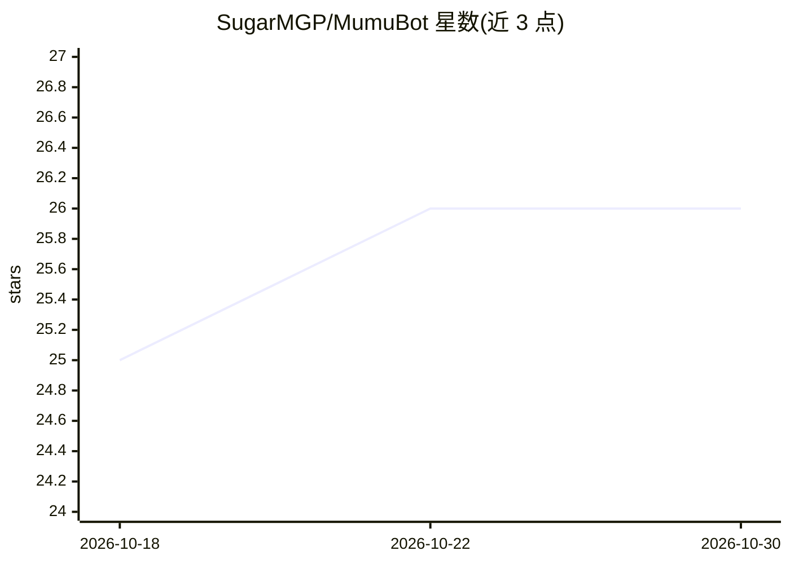

# SugarMGP/MumuBot

⭐ 26 · Go · GPL-3.0 · 推送 2026-10-29 · [GitHub](https://github.com/SugarMGP/MumuBot) · 个人维护 · 中文 README

**运行在 QQ 群与私聊里的拟人智能体，会聊天记事并融入群文化**

沐沐是基于 Go 与 eino 框架构建的 QQ 群聊/私聊智能体：通过 ReAct 循环自主决定是否接话，具备话题工作记忆、基于 pgvector 的长期记忆、群友画像、情绪系统、多模态理解与表情包系统，支持 MCP 协议扩展外部工具并提供 Web 管理后台。部署依赖 PostgreSQL+pgvector、SnowLuma（OneBot 11 实现）与 OpenAI 格式兼容模型 API；可用 Docker Compose 或 GitHub Release 三平台发布包运行。README 声明项目仍在快速迭代，且 QQ 机器人存在账号风控风险。

## 筛选速览

| 维度 | 判定 | 备注 |
|---|---|---|
| AI 角色 | `ai-native` | 本体是模型或模型工具 |
| 许可风险 | `viral` | GPL-3.0 |
| 部署形态 | `self-host` | docker 或自建部署 |
| 模型依赖 | — | README 未给出锁定关系 |
| 硬件要求 | — | 无带数字的原话,不猜 |
| 安装摩擦 | `low` | 无编译、无系统依赖或容器化 |
| 成熟度 | `idea` | |

## 能力要点

- ReAct 循环自主判断是否接话或保持沉默
- 基于 pgvector/pg_trgm 的长期记忆与话题归档召回
- MCP 协议扩展外部工具（SSE/Stdio）
- 群聊与好友私聊独立人格模板与话题整理

## 适用场景

- 让一个拟人智能体常驻 QQ 群参与聊天
- 通过管理后台查看智能体记住的内容与话题
- 用 MCP 接入外部工具扩展智能体能力

## 场景标签

`聊天机器人` `Agent 记忆` · 领域:Agent 开发

## 证据(README 行号)

> L19: 沐沐是一个运行在 QQ 群和好友私聊里的智能体。跟常见的问答机器人不同，沐沐会自己判断什么时候该说话、什么时候闭嘴，会记住聊过的事，会学群里的黑话和梗，还会随着聊天慢慢建立对每个群友的了解。
> L27: - 🧠 **ReAct 智能体** — 通过观察、思考、行动循环，自主判断是否接话、查询信息或保持沉默

## 星数曲线

2026-10-18 25 → 2026-10-30 26（+1）

---
*卡片 v1 · prompt 1.4 · 生成 2026-10-26 · 置信度 mid · 依据 README sha `5126975b9192` · [字段定义](../../DATASET.md)*
