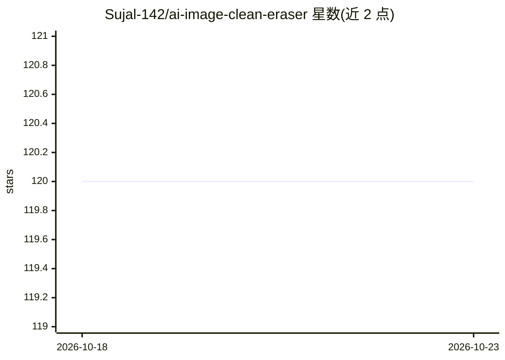

# Sujal-142/ai-image-clean-eraser

⭐ 120 · HTML · 推送 2026-10-22 · [GitHub](https://github.com/Sujal-142/ai-image-clean-eraser) · 个人维护

**文档真伪核验平台：哈希+区块链存证+AI 篡改检测**

CertiSwap 将 PDF、图片等文档计算 Merkle 哈希并写入 Ethereum/Polygon 链与 IPFS，生成可扫码核验的 QR，文档改动即哈希失效并显示 INVALID。提供批量处理、像素级取证比对模块（AI 神经网络检测修图/复制移动/元数据篡改，经 ONNX Runtime 服务）、审计日志与 GDPR 可撤销机制。技术栈为 Rust + React PWA + PyTorch。README 有下载与文档链接，但未给出源码构建或部署命令；仓库主题标签（text remover/image editing）与 README 内容不一致。

## 筛选速览

| 维度 | 判定 | 备注 |
|---|---|---|
| AI 角色 | `ai-enhanced` | 去掉 AI 部分产品仍成立 |
| 许可风险 | `none` | — |
| 部署形态 | `None` |  |
| 模型依赖 | — | README 未给出锁定关系 |
| 硬件要求 | — | 无带数字的原话,不猜 |
| 安装摩擦 | `low` | 无编译、无系统依赖或容器化 |
| 成熟度 | — | 结构信号不足 |

## 能力要点

- SHA-3 哈希 + Ed25519 签名写入 Ethereum/Polygon/IPFS
- AI 异常检测模块识别修图、copy-move 与元数据篡改
- QR 离线核验与批量密封（10,000 文件）
- 42 种语言界面与 GDPR 哈希撤销机制

## 适用场景

- 大学文凭签发后供雇主扫码即时核验
- 政府合同签署与审计留痕
- 医疗记录完整性保障
- 争议文档的像素级取证比对

## 场景标签

`图像视频处理` · 领域:感知与多模态

## 证据(README 行号)

> L23: |**AI Anomaly Detection**|Neural network trained on 10M+ document forgeries detects photoshopping, copy-move, and m
> L40: 4. **Forensic Mode** → For disputed documents, activate the AI layer to highlight differences at the pixel level, w

## 星数曲线

2026-10-18 120 → 2026-10-23 120（+0）

---
*卡片 v1 · prompt 1.4 · 生成 2026-10-23 · 置信度 low · 依据 README sha `3549c0e70f63` · [字段定义](../../DATASET.md)*
