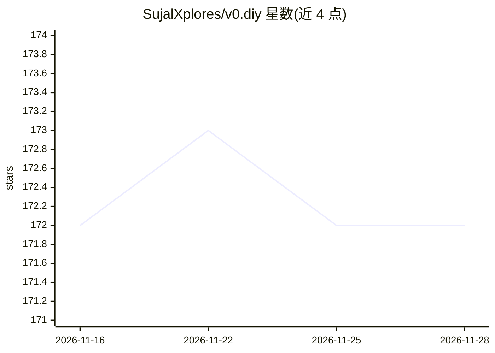

# SujalXplores/v0.diy

⭐ 172 · TypeScript · MIT · 推送 2026-11-27 · [GitHub](https://github.com/SujalXplores/v0.diy) · [官网](https://v0-diy.vercel.app) · 个人维护

**自托管的 v0.app 克隆：自然语言生成 React 应用**

基于 Next.js 16 的开源 Web 应用，复刻 v0.app 的 agentic 应用生成工作流：用户用自然语言描述应用，通过官方 v0 Platform API v2 实时观看 AI 思考、读写文件、执行命令，并在隔离源的沙盒预览中查看生成结果。用户自带 v0 API key（AES-256-GCM 加密存储于服务端），支持项目/聊天管理、代码编辑、版本回滚、ZIP 下载与一键部署到 Vercel。数据存 PostgreSQL（Drizzle ORM），需 Node.js 22+、pnpm 10+ 环境自行部署运行。

## 筛选速览

| 维度 | 判定 | 备注 |
|---|---|---|
| AI 角色 | `ai-native` | 本体是模型或模型工具 |
| 许可风险 | `permissive` | MIT |
| 部署形态 | `library` | 以包/库形式分发 |
| 模型依赖 | — | README 未给出锁定关系 |
| 硬件要求 | — | 无带数字的原话,不猜 |
| 安装摩擦 | `low` | 无编译、无系统依赖或容器化 |
| 成熟度 | — | 结构信号不足 |

## 能力要点

- 用户自带 v0 API key，密钥 AES-256-GCM 加密存储、不进浏览器
- 实时流式展示 AI 思考、文件读写、搜索与命令执行过程
- 隔离源的签名短时 token 沙盒预览，生成代码不接触会话
- 项目与聊天管理、GitHub/ZIP/本地目录导入、一键部署 Vercel

## 适用场景

- 想自托管一个类 v0.app 的 AI 应用生成器，掌握自己的数据与域名
- 用自己的 v0 API key 在私有部署中生成 React/shadcn 组件
- 生成后直接编辑代码、回滚版本并部署到 Vercel

## 场景标签

`代码生成` · 领域:编码与开发

## 证据(README 行号)

> L12: Describe an app in plain English. Watch v0 think, write files, run commands and ship a live preview. On your own do
> L31: v0.app is a great AI app builder, but it's a hosted product. **v0.diy** gives you the same agentic workflow, built 

## 星数曲线

2026-11-16 172 → 2026-11-28 172（+0）

---
*卡片 v1 · prompt 1.4 · 生成 2026-11-17 · 置信度 mid · 依据 README sha `bd65edbd895c` · [字段定义](../../DATASET.md)*
