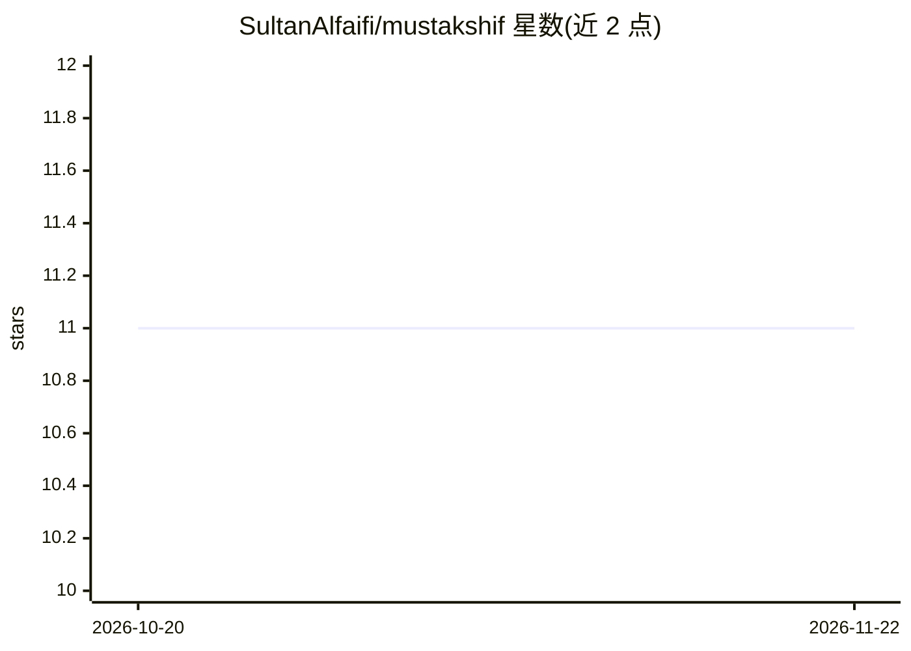

# SultanAlfaifi/mustakshif

⭐ 11 · Python · Apache-2.0 · 推送 2026-11-21 · [GitHub](https://github.com/SultanAlfaifi/mustakshif) · [官网](https://github.com/SultanAlfaifi/mustakshif/releases/latest) · 个人维护

**为 Windows PC 扫描硬件并推荐可运行的本地模型**

面向 Windows 的桌面应用与 CLI：扫描本机 CPU、RAM、GPU、显存、存储与本地 Ollama 安装，结合用户偏好（语言、任务、上下文、视觉、许可等）对 Ollama 官方库的模型目录打分，输出最佳综合/质量/速度/轻量/流行五个视角的推荐。目录由每日定时工作流从官方 Ollama 库生成，应用本身不下载模型权重；拉取模型需用户显式确认。支持离线缓存回退、JSON 输出，硬件与偏好数据留在本地。0.4.0 安装包未签名，需核对 SHA-256 校验值。

## 筛选速览

| 维度 | 判定 | 备注 |
|---|---|---|
| AI 角色 | `ai-ecosystem` | LLM/agent 周边工具 |
| 许可风险 | `permissive` | Apache-2.0 |
| 部署形态 | `desktop` | 安装包/桌面程序 |
| 模型依赖 | local-ok | 支持本地模型 |
| 硬件要求 | — | 无带数字的原话,不猜 |
| 安装摩擦 | `low` | 无编译、无系统依赖或容器化 |
| 成熟度 | `idea` | |

## 能力要点

- 硬件扫描 + 偏好访谈生成可解释的五视角推荐
- 每日自动更新官方 Ollama 库索引，含数百个可运行变体
- 拉取模型前需显式确认，无遥测与硬件上传
- 桌面与 CLI 共享同一推荐引擎并支持 JSON 输出

## 适用场景

- 为我的 Windows 电脑找出能跑得动的本地模型
- 按语言、速度、许可偏好筛选 Ollama 模型
- 在脚本中用 JSON 输出批量盘点可用模型

## 场景标签

 · 领域:本地 AI 模型选择/基础设施

## 证据(README 行号)

> L7:  A privacy-first Windows app and CLI that scans your hardware, understands your
> L39: - Scores hardware fit, task fit, language fit, speed, quality, official pull
> L43: - Recommends local Ollama models and clearly labels optional cloud models.

## 星数曲线

2026-10-20 11 → 2026-11-22 11（+0）

---
*卡片 v1 · prompt 1.4 · 生成 2026-11-18 · 置信度 high · 依据 README sha `0f663b81703b` · [字段定义](../../DATASET.md)*
