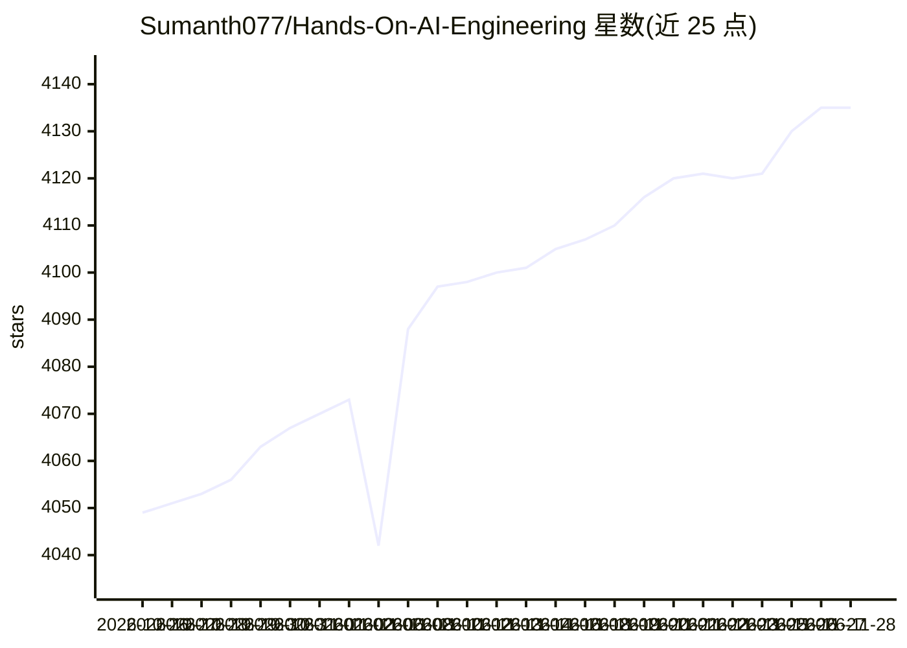

# Sumanth077/Hands-On-AI-Engineering

⭐ 4,135 · Python · 推送 2026-11-26 · [GitHub](https://github.com/Sumanth077/Hands-On-AI-Engineering) · [官网](https://aiengineering.beehiiv.com) · 个人维护

**AI 工程实践项目合集：覆盖 Agent、RAG、OCR 等场景**

MIT 许可的策展型仓库，收录多模态实践项目，按 AI Agents、OCR、Audio 等类别组织，每个项目附完整代码、安装说明与文档。项目使用 OpenAI、Anthropic、Google 与开源模型等多种提供方，部分项目支持 Ollama 本地运行。仓库接受 PR 贡献并定期更新，定位为学习、实验与构建真实 AI 应用的参考资料集合。

## 筛选速览

| 维度 | 判定 | 备注 |
|---|---|---|
| AI 角色 | `ai-knowledge` | 知识聚合/清单类 |
| 许可风险 | `permissive` | — |
| 部署形态 | `None` |  |
| 模型依赖 | local-ok | 支持本地模型 |
| 硬件要求 | — | 无带数字的原话,不猜 |
| 安装摩擦 | `low` | 无编译、无系统依赖或容器化 |
| 成熟度 | — | 结构信号不足 |

## 能力要点

- 按类别组织的多个实践项目，附完整代码与安装说明
- 项目覆盖语言模型、多模态、OCR、RAG 与 AI Agent
- 使用多家模型提供方，部分项目可完全本地运行（Ollama + BGE 嵌入）

## 适用场景

- 我想找可动手实践的 Agent 或 RAG 项目来学习
- 我想参考现成实现搭建 OCR 或文档问答应用
- 我想找完全离线可运行的 AI 项目作为起点

## 场景标签

`教程课程` `RAG` `OCR` · 领域:知识与检索

## 证据(README 行号)

> L10: A curated collection of practical, production-ready AI projects across multiple modalities, including language mode
> L18: - **Learn by Doing**: Each project includes complete code, setup instructions, and documentation
> L24: ## 🗂️ Project Categories

## 星数曲线

2026-10-26 4,049 → 2026-11-28 4,135（+86）

---
*卡片 v1 · prompt 1.4 · 生成 2026-11-27 · 置信度 high · 依据 README sha `3a55acd60ff3` · [字段定义](../../DATASET.md)*
