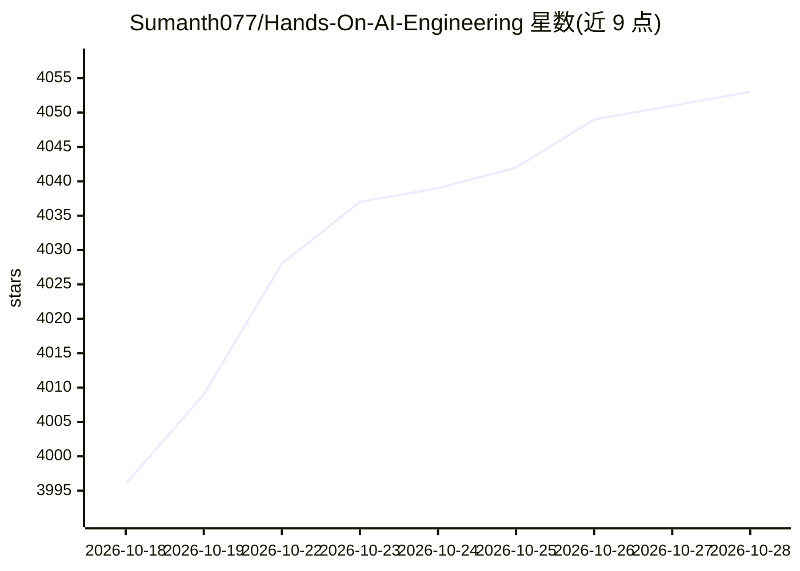

# Sumanth077/Hands-On-AI-Engineering

⭐ 4,056 · Python · 推送 2026-10-21 · [GitHub](https://github.com/Sumanth077/Hands-On-AI-Engineering) · [官网](https://aiengineering.beehiiv.com) · 个人维护

**实践型 AI 工程项目合集：覆盖 Agent、OCR、RAG、音频等多模态**

一个策划的 AI 项目集合，按 AI Agents、OCR、Audio、Multimodal 等类别组织约 60 个项目。Agent 类涵盖多智能体研究助理、金融分析、离线医疗检索、语音 GitHub 操作等；OCR 类提供票据结构化、LaTeX 公式识别、处方数字化；音频类含多语种翻译与电话客服语音代理。每个项目附完整代码、安装说明与文档，示例中搭配 OpenAI、Anthropic、Google、开源模型及 Ollama 本地运行。供学习、实验与构建实际应用的开发者使用。

## 筛选速览

| 维度 | 判定 | 备注 |
|---|---|---|
| AI 角色 | `ai-knowledge` | 知识聚合/清单类 |
| 许可风险 | `permissive` | — |
| 部署形态 | `None` |  |
| 模型依赖 | local-ok | 支持本地模型 |
| 硬件要求 | — | 无带数字的原话,不猜 |
| 安装摩擦 | `low` | 无编译、无系统依赖或容器化 |
| 成熟度 | — | 结构信号不足 |

## 能力要点

- 按 Agent/OCR/Audio/Multimodal 四大类组织数十个项目
- 多个项目支持经 Ollama 全本地运行（含完全离线的医疗与工业场景）
- 覆盖 RAG、多智能体协作、语音代理、文档结构化提取等用例
- MIT 许可，接受 PR，声明定期更新

## 适用场景

- 学习并复现生产可用的 AI Agent 与 RAG 项目
- 寻找 OCR、音频、多模态场景的参考实现
- 搭建完全本地离线的文档问答或代理系统

## 场景标签

`精选清单` `教程课程` · 领域:学习与行业

## 证据(README 行号)

> L10: A curated collection of practical, production-ready AI projects across multiple modalities, including language mode
> L24: ## 🗂️ Project Categories

## 星数曲线

2026-10-18 3,996 → 2026-10-28 4,053（+57）

---
*卡片 v1 · prompt 1.4 · 生成 2026-10-20 · 置信度 high · 依据 README sha `80f2ef2215a1` · [字段定义](../../DATASET.md)*
