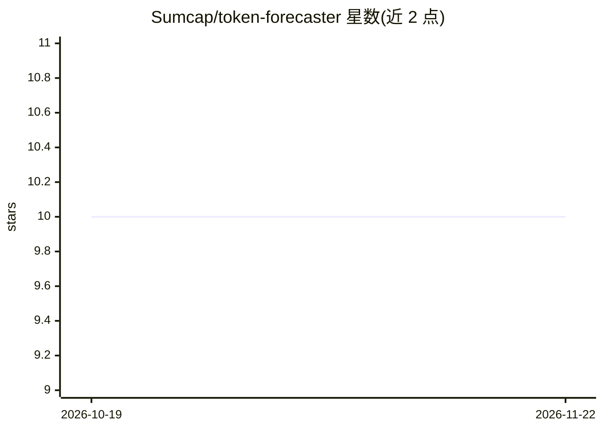

# Sumcap/token-forecaster

⭐ 10 · TypeScript · MIT · 推送 2026-09-20 · [GitHub](https://github.com/Sumcap/token-forecaster) · 组织维护

**预测 Claude 回复/agent 回合输出 token 用量的本地工具**

围绕 Claude Code 的输出 token 预测工具：基于内置的分位数查找表与梯度提升校正模型，按 API 调用、用户回合、会话三个时间尺度给出 p50/p90/p99 预测区间，运行中通过状态栏实时对照进度。提供四个界面：Claude Code 状态行、macOS 菜单栏应用、本地 dashboard（127.0.0.1）与 Chrome 扩展。输入 token 通过 Anthropic 计数端点精确统计，预测器不读取提示词原文；可用本地历史做后训练拟合。README 说明内置校准仅拟合单一用户历史，重负载区间覆盖率低于承诺值。

## 筛选速览

| 维度 | 判定 | 备注 |
|---|---|---|
| AI 角色 | `ai-ecosystem` | LLM/agent 周边工具 |
| 许可风险 | `permissive` | MIT |
| 部署形态 | `library` | 以包/库形式分发 |
| 模型依赖 | locked-api |  |
| 硬件要求 | — | 无带数字的原话,不猜 |
| 安装摩擦 | `low` | 无编译、无系统依赖或容器化 |
| 成熟度 | `idea` | |

## 能力要点

- 三尺度（调用/回合/会话）p50/p90/p99 预测，运行中实时对照
- 预测器不读取提示词文本，仅使用计数与 agent 循环状态特征
- 支持本地历史后训练，更新须经留出集 bootstrap 显著性门槛
- 四个界面共享一个本地 daemon：状态行/菜单栏/dashboard/Chrome 扩展

## 适用场景

- 为上下文窗口预留 token 余量
- 发现运行过长的 agent 循环
- 判断任务是否值得拆分

## 场景标签

`LLM 可观测性` · 领域:评测与运维

## 证据(README 行号)

> L5: Token Forecaster estimates how many output tokens a Claude reply, or a whole agent turn, is likely to use, then show
> L25: Token Forecaster runs on four surfaces, all fed by one local daemon: the Claude Code status line, a macOS menu bar 
> L62: Input tokens are counted, not guessed: Anthropic's count endpoint gives the exact number and a local estimate cover

## 星数曲线

2026-10-19 10 → 2026-11-22 10（+0）

---
*卡片 v1 · prompt 1.4 · 生成 2026-11-20 · 置信度 low · 依据 README sha `92d56a603dee` · [字段定义](../../DATASET.md)*
