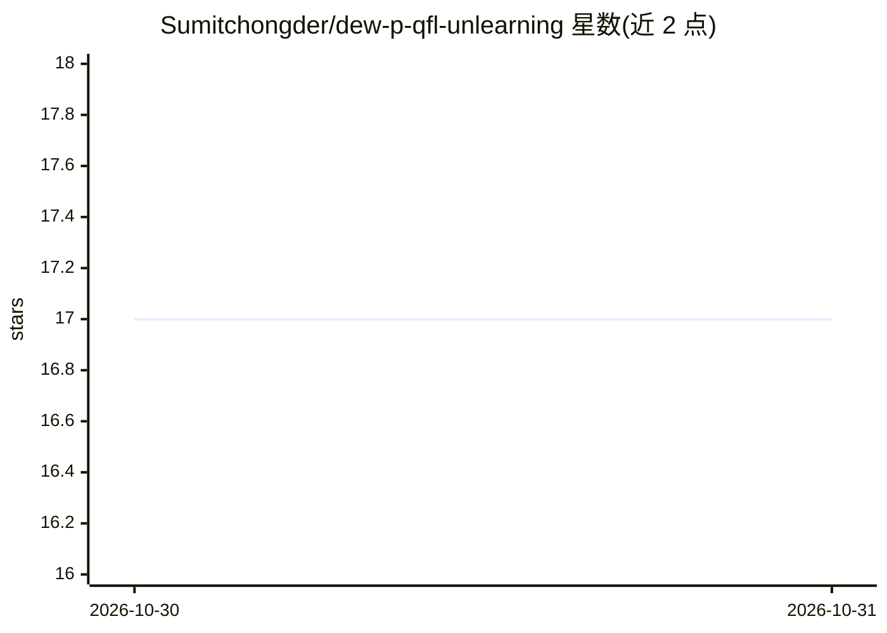

# Sumitchongder/dew-p-qfl-unlearning

⭐ 17 · Python · MIT · 推送 2026-08-19 · [GitHub](https://github.com/Sumitchongder/dew-p-qfl-unlearning) · [官网](https://arxiv.org/abs/2608.17069) · 个人维护

**量子联邦学习中选择性遗忘客户端的剪枝方法参考实现**

论文 arXiv:2608.17069 的参考实现：在量子联邦学习（Qiskit 模拟的变分量子分类器 + FedAvg）场景下，响应对某客户端的遗忘请求，用量子 Fisher 信息（参数移位规则估计）与门纠缠结构权重之积为每个电路参数打分，剪掉低分参数并短暂微调，实现选择性遗忘；与全量重训准确率统计无显著差异、耗时约低 16 倍。提供完整源码、实验脚本、SLURM 链、已生成的图表与测试。

## 筛选速览

| 维度 | 判定 | 备注 |
|---|---|---|
| AI 角色 | `ai-native` | 本体是模型或模型工具 |
| 许可风险 | `permissive` | MIT |
| 部署形态 | `None` |  |
| 模型依赖 | — | README 未给出锁定关系 |
| 硬件要求 | — | 无带数字的原话,不猜 |
| 安装摩擦 | `low` | 无编译、无系统依赖或容器化 |
| 成熟度 | — | 结构信号不足 |

## 能力要点

- 纠缠加权的参数剪枝实现量子联邦遗忘（EWP）
- Qiskit 全流程：数据生成、变分量子电路、FedAvg、QFIM 估计、5 种基线与评测
- 默认配置在单核 CPU 约 30-45 分钟跑完，结果以 JSON/CSV 缓存可复现
- 附带论文全部图表与 SLURM 四阶段 HPC 脚本

## 适用场景

- 复现论文中的量子联邦遗忘实验
- 在跨机构供应链风险预测中响应对客户端的遗忘请求
- 扩展自定义 ansatz、数据集或剪枝基线做后续研究

## 场景标签

 · 领域:量子机器学习/联邦学习

## 证据(README 行号)

> L9: A reference implementation of **entanglement-weighted parameter pruning**
> L58: retained clients. We implement the full pipeline in Qiskit for a
> L59: four-qubit data-re-uploading ansatz trained with FedAvg across five

## 星数曲线

2026-10-30 17 → 2026-10-31 17（+0）

---
*卡片 v1 · prompt 1.4 · 生成 2026-10-30 · 置信度 high · 依据 README sha `aac0b6cbaa96` · [字段定义](../../DATASET.md)*
