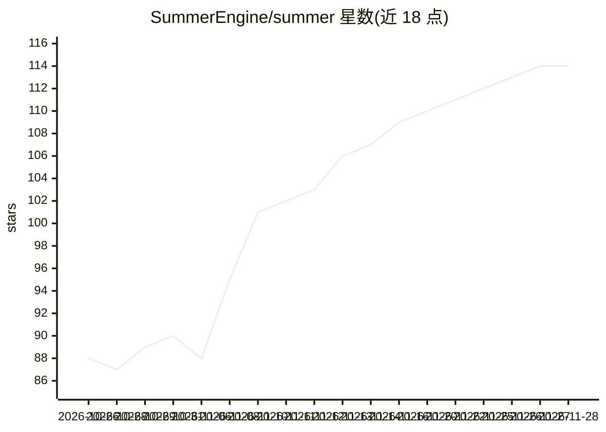

# SummerEngine/summer

⭐ 114 · TypeScript · MIT · 推送 2026-11-25 · [GitHub](https://github.com/SummerEngine/summer) · [官网](https://summerengine.com/) · 组织维护

**让 AI agent 构建、测试、发布完整游戏的 MCP 服务、CLI 与技能包**

本仓库是连接 AI 编码 agent 与 Summer Engine 游戏引擎的工具层，包含 MCP server（本地与云端两种）、summer CLI 和游戏开发技能库。agent 通过这些工具驱动引擎编辑器：搭建场景、写脚本、运行游戏、截图、读取错误，并执行云端操作如资产生成、商店发布、定价与分析。技能覆盖移动、战斗、多人、VFX、音频、UI 等主题。引擎本体为独立桌面应用（约 660 MB）由 CLI 下载；云端功能需注册 Summer 账号，生成资产与付费构建消耗 credits；权限通过 Studio 中六个开关控制。

## 筛选速览

| 维度 | 判定 | 备注 |
|---|---|---|
| AI 角色 | `ai-ecosystem` | LLM/agent 周边工具 |
| 许可风险 | `permissive` | MIT |
| 部署形态 | `library` | 以包/库形式分发 |
| 模型依赖 | — | README 未给出锁定关系 |
| 硬件要求 | — | 无带数字的原话,不猜 |
| 安装摩擦 | `low` | 无编译、无系统依赖或容器化 |
| 成熟度 | — | 结构信号不足 |

## 能力要点

- MCP server + CLI + 游戏开发技能打包为单个 npm 包 summer-engine
- 支持 Claude Code、Cursor、Codex 等多种 agent 的接入配置命令
- .summer/ 项目记忆使新 agent 可续接上次中断的项目
- Studio 提供六个 agent 权限开关与操作审计、审批链接

## 适用场景

- 让 Claude Code 或 Cursor 等 agent 从模板或概念图直接搭出一款可玩的多人游戏
- 通过 agent 生成音效、音乐、语音、图像、3D 模型等游戏资产
- 将构建好的游戏发布到 summer.games 商店并读取玩家数据分析

## 场景标签

`编码 Agent` · 领域:编码与开发

## 证据(README 行号)

> L3: ### The game engine built for AI.
> L43: Summer Engine is the game engine built for AI. This repo connects your AI coding agent (Claude Code, Cursor, Codex,
> L47: |**MCP server** (`summer mcp`)|Tools your agent calls to drive the running editor: build scenes, write scripts, pla

## 星数曲线

2026-10-26 88 → 2026-11-28 114（+26）

---
*卡片 v1 · prompt 1.4 · 生成 2026-11-28 · 置信度 high · 依据 README sha `b5041cd2d947` · [字段定义](../../DATASET.md)*
