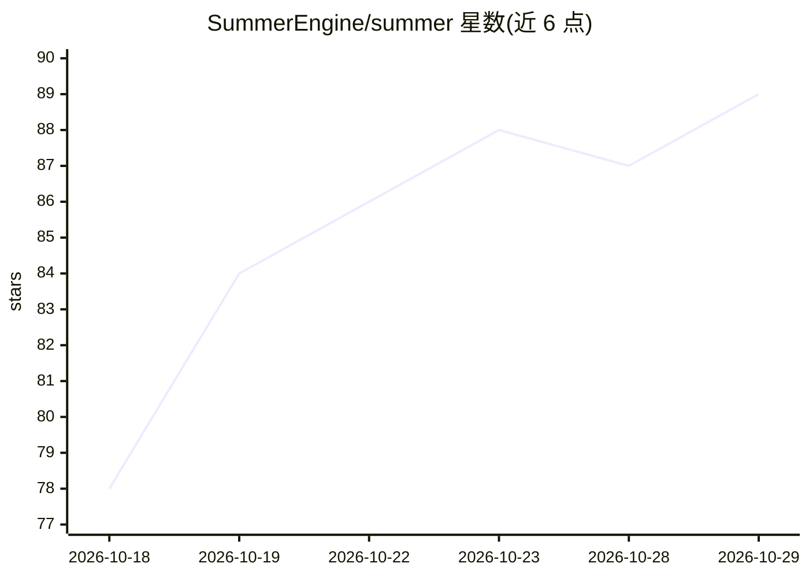

# SummerEngine/summer

⭐ 89 · TypeScript · MIT · 推送 2026-10-28 · [GitHub](https://github.com/SummerEngine/summer) · [官网](https://summerengine.com/) · 组织维护

**让 AI 编程 agent 构建、测试并发布完整游戏的 MCP 服务器与 CLI**

Summer Engine 的接入层：以单一 npm 包提供 MCP 服务器、游戏开发技能与 summer CLI，把 Claude Code、Cursor、Codex 等编程 agent 连接到 Summer Engine 桌面应用。Agent 可通过 MCP 工具搭建场景、编写脚本、运行游戏、截图和读取错误，登录后还能执行云端操作：生成图片/3D/音频等资产、发布到 summer.games 商店、读取分析数据。技能库覆盖移动、战斗、多人联机、UI、关卡设计等主题。需 Node 22+；本仓库不是引擎本体，引擎应用（约 660 MB）由 CLI 下载。发布与付费操作有六档权限开关控制，资产生成与付费构建消耗 Summer 积分。

## 筛选速览

| 维度 | 判定 | 备注 |
|---|---|---|
| AI 角色 | `ai-ecosystem` | LLM/agent 周边工具 |
| 许可风险 | `permissive` | MIT |
| 部署形态 | `library` | 以包/库形式分发 |
| 模型依赖 | — | README 未给出锁定关系 |
| 硬件要求 | — | 无带数字的原话,不猜 |
| 安装摩擦 | `low` | 无编译、无系统依赖或容器化 |
| 成熟度 | — | 结构信号不足 |

## 能力要点

- MCP 服务器驱动本地引擎编辑器：搭建场景、写脚本、运行游戏、截图、读错误
- 单人 npm 包内含 MCP 服务器、CLI 与游戏开发技能库
- 支持发布游戏到 summer.games 商店并读取玩家分析数据
- 六档 agent 权限开关，删除与联系他人默认需人工确认

## 适用场景

- 让 Claude Code 或 Cursor 等编程 agent 从零搭建并运行一款游戏
- 通过对话让 agent 生成游戏资产（图片、3D 模型、音效、配音）
- 让 agent 测试自己做的游戏：试玩、截图、读取调试器
- 把做好的游戏发布到 summer.games 并查看玩家数据

## 场景标签

`编码 Agent` · 领域:编码与开发

## 证据(README 行号)

> L5: **Any agent builds, tests and publishes a full multiplayer game. MCP server · game-dev skills · `summer` CLI, in one
> L43: Summer Engine is the game engine built for AI. This repo connects your AI coding agent (Claude Code, Cursor, Codex,
> L47: |**MCP server** (`summer mcp`)|Tools your agent calls to drive the running editor: build scenes, write scripts, pla

## 星数曲线

2026-10-18 78 → 2026-10-29 89（+11）

---
*卡片 v1 · prompt 1.4 · 生成 2026-10-23 · 置信度 high · 依据 README sha `b76aa0afce3a` · [字段定义](../../DATASET.md)*
