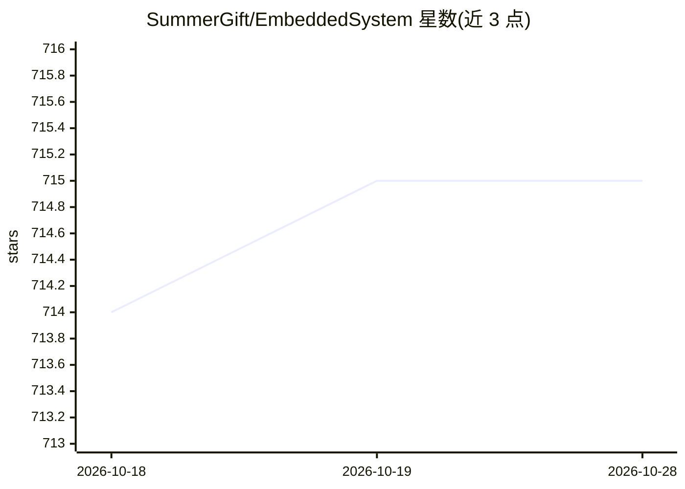

# SummerGift/EmbeddedSystem

⭐ 716 · Jupyter Notebook · MIT · 推送 2026-05-05 · [GitHub](https://github.com/SummerGift/EmbeddedSystem) · 个人维护 · 中文 README

**嵌入式系统与计算机体系架构的学习笔记知识库**

个人维护的技术知识仓库，收录嵌入式系统基础（ARM、RTOS、Embedded Linux、Network）、多种编程语言（C/C++/Python/Java/JavaScript/Go）、数据结构、编译原理、数学等学习笔记与日常工作技巧，并附有作者对嵌入式工程师知识体系、技术深度与 Debug 方法论的思考文章。内容以文档形式组织，长期更新，不含可运行代码或安装流程。

## 筛选速览

| 维度 | 判定 | 备注 |
|---|---|---|
| AI 角色 | `ai-knowledge` | 知识聚合/清单类 |
| 许可风险 | `permissive` | MIT |
| 部署形态 | `None` |  |
| 模型依赖 | — | README 未给出锁定关系 |
| 硬件要求 | — | 无带数字的原话,不猜 |
| 安装摩擦 | `medium` | 含编译或系统依赖之一 |
| 成熟度 | — | 结构信号不足 |

## 能力要点

- 覆盖 ARM/RTOS/Embedded Linux/Network 等嵌入式基础主题
- 收录 C/C++/Python/Java/JavaScript/Go 等多种编程语言笔记
- 包含数据结构、编译原理、计算机组成原理等理论基础内容
- 附作者关于嵌入式工程师成长路径与 Debug 方法论的文章

## 适用场景

- 系统学习嵌入式系统与计算机体系架构基础知识
- 查找多种编程语言的学习笔记与技巧
- 了解嵌入式工程师的知识体系与成长思路

## 场景标签

 · 领域:嵌入式系统/计算机科学教育

## 证据(README 行号)

> L3: 总结嵌入式系统基础知识、编程语言、高效工具等内容。
> L13: 技术文档与学习记录：

## 星数曲线

2026-10-18 714 → 2026-10-28 715（+1）

---
*卡片 v1 · prompt 1.4 · 生成 2026-10-21 · 置信度 high · 依据 README sha `68bc98dd421b` · [字段定义](../../DATASET.md)*
