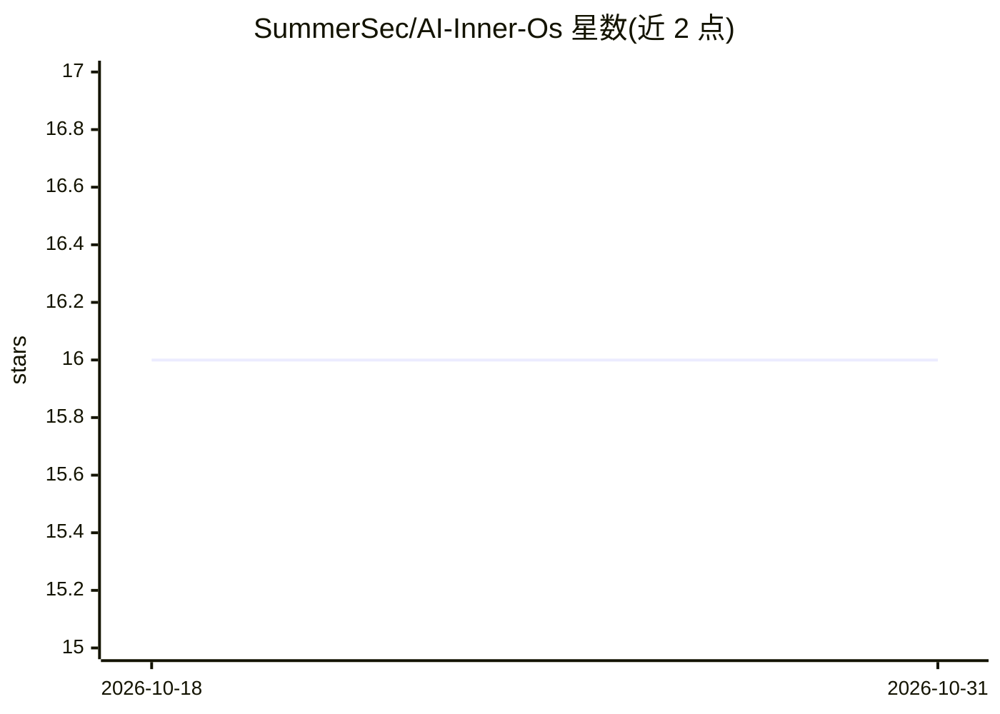

# SummerSec/AI-Inner-Os

⭐ 16 · Python · Apache-2.0 · 推送 2026-05-10 · [GitHub](https://github.com/SummerSec/AI-Inner-Os) · 个人维护 · 中文 README

**为 AI CLI 工具注入可见内心独白层的插件**

面向 Claude Code、Codex CLI、Cursor、OpenCode CLI、Hermes Agent、OpenClaw 六个平台的插件：通过协议注入（SKILL.md 定义单一行为协议，各平台适配器派生），让 AI 在完成主任务的同时可选输出带 ▎InnerOS： 前缀的自由独白；默认自由模式，可切换 6 种预设人格或自定义人格，人格仅影响独白不影响主任务。各平台以插件市场/插件包方式安装，Claude Code 的 Hook 生命周期支持最完整（含压缩连续性、子代理生命周期）。可选 user-profile 技能默认关闭。Roadmap 中个性化风格、情绪状态机等阶段尚未实现。

## 筛选速览

| 维度 | 判定 | 备注 |
|---|---|---|
| AI 角色 | `ai-ecosystem` | LLM/agent 周边工具 |
| 许可风险 | `permissive` | Apache-2.0 |
| 部署形态 | `None` |  |
| 模型依赖 | — | README 未给出锁定关系 |
| 硬件要求 | — | 无带数字的原话,不猜 |
| 安装摩擦 | `low` | 无编译、无系统依赖或容器化 |
| 成熟度 | — | 结构信号不足 |

## 能力要点

- 单源协议 protocol/SKILL.md，六平台适配器统一派生
- 6 种预设人格 + personas/custom/ 自定义人格文件
- Claude Code 覆盖 SessionStart/PostToolUse/PreCompact/Subagent 等完整 Hook 生命周期
- 可选 user-profile-distillation 技能，默认禁用且不主动读取历史

## 适用场景

- 让终端里的 AI 编程助手在干活时输出一层内心独白
- 给独白换上特定人格风格（傲娇/冷淡/哲学家等）
- 让 AI 在工具失败、上下文压缩时保持连续的表达

## 场景标签

`编码 Agent` · 领域:编码与开发

## 证据(README 行号)

> L25: AI Inner OS is a plugin for AI CLI tools, supporting **Claude Code**, **Codex CLI**, **Cursor**, **OpenCode CLI**, 
> L27: Through protocol injection, it enables AI to output a visible layer of free-form inner monologue while completing t
> L165: The Inner OS behavior protocol is defined in `protocol/SKILL.md`, serving as the single source of truth. All platf

## 星数曲线

2026-10-18 16 → 2026-10-31 16（+0）

---
*卡片 v1 · prompt 1.4 · 生成 2026-10-30 · 置信度 high · 依据 README sha `9d8d56666cb6` · [字段定义](../../DATASET.md)*
