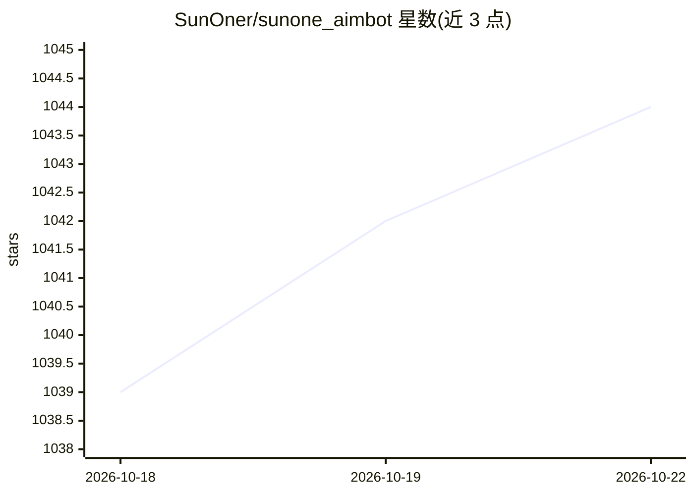

# SunOner/sunone_aimbot

⭐ 1,044 · Python · MIT · 推送 2026-05-22 · [GitHub](https://github.com/SunOner/sunone_aimbot) · [官网](https://discord.gg/37WVp6sNEh) · 个人维护

**面向 FPS 游戏的 AI 自瞄工具（YOLO 检测自动瞄准）**

基于 YOLOv8/YOLOv10、PyTorch 与 TensorRT 的 FPS 游戏自瞄程序：检测游戏画面中的敌人并自动控制瞄准，仓库内模型由超过 30,000 张来自 Warface、CS2、Fortnite 等游戏的图像训练。提供 React 辅助面板（配置/导出/训练/测试），支持 Windows 与 Ubuntu/Linux（部分功能 Windows 限定），README 警告使用可能导致封号，推荐 RTX 20 系列及以上显卡。另有更新的 C++ 分支 Sunone Aimbot 2，Windows 日常使用建议转向该分支。

## 筛选速览

| 维度 | 判定 | 备注 |
|---|---|---|
| AI 角色 | `ai-native` | 本体是模型或模型工具 |
| 许可风险 | `permissive` | MIT |
| 部署形态 | `library` | 以包/库形式分发 |
| 模型依赖 | — | README 未给出锁定关系 |
| 硬件要求 | — | 无带数字的原话,不猜 |
| 安装摩擦 | `medium` | 含编译或系统依赖之一 |
| 成熟度 | — | 结构信号不足 |

## 能力要点

- YOLOv8/YOLOv10 + PyTorch/TensorRT 目标检测自瞄
- 模型由 30,000+ 张 FPS 游戏图像训练
- React 辅助面板：配置/导出/训练/测试一键设置
- 支持 Windows 与 Ubuntu/Linux（捕获方式部分限定 Windows）

## 适用场景

- 在 FPS 游戏中自动检测敌人并控制瞄准
- 导出/训练自定义检测模型并测试
- 在 Ubuntu/Linux 环境下运行检测推理

## 场景标签

`目标检测` `GUI 自动化` · 领域:效率与自动化

## 证据(README 行号)

> L11: Sunone Aimbot is an AI-powered aim bot for first-person shooter games. It leverages the YOLOv8 and YOLOv10 models, 
> L53:  CUDA: 12.8

## 星数曲线

2026-10-18 1,039 → 2026-10-22 1,044（+5）

---
*卡片 v1 · prompt 1.4 · 生成 2026-10-21 · 置信度 mid · 依据 README sha `7bde913498dc` · [字段定义](../../DATASET.md)*
