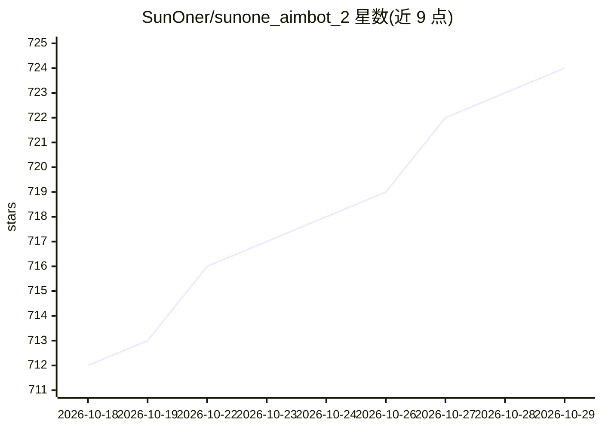

# SunOner/sunone_aimbot_2

⭐ 724 · C++ · NOASSERTION · 推送 2026-10-28 · [GitHub](https://github.com/SunOner/sunone_aimbot_2) · 个人维护

**面向 FPS/TPS 游戏的 AI 自瞄工具（C++，YOLO 模型）**

C++ 编写的屏幕目标检测自瞄程序：读取用户提供的 .onnx 模型，实时检测游戏画面目标并通过鼠标硬件设备（KMBOX/MAKCU）或鼠标移动执行瞄准。提供两种预编译 Windows 版本：DirectML 版支持任意现代 GPU，CUDA+TensorRT 版限 NVIDIA GTX 1660 及以上并需 CUDA 13.1。运行 ai.exe 即可使用，无需编译；也可按 docs/build.md 从源码构建。设置通过 HOME 键覆盖层调整。

## 筛选速览

| 维度 | 判定 | 备注 |
|---|---|---|
| AI 角色 | `ai-native` | 本体是模型或模型工具 |
| 许可风险 | `none` | NOASSERTION |
| 部署形态 | `desktop` | 安装包/桌面程序 |
| 模型依赖 | — | README 未给出锁定关系 |
| 硬件要求 | — | 无带数字的原话,不猜 |
| 安装摩擦 | `medium` | 含编译或系统依赖之一 |
| 成熟度 | — | 结构信号不足 |

## 能力要点

- 预编译 .exe 版本：DirectML（全 GPU）与 CUDA+TensorRT（NVIDIA 专属）
- 读取用户放置的 .onnx 模型，首启自动导出
- 通过覆盖层（HOME 键）进行全部设置
- 支持 KMBOX/MAKCU 等鼠标硬件设备

## 适用场景

- 在不编译代码的情况下运行 AI 自瞄（下载即用）
- 在 AMD/Intel/集成显卡设备上使用 DirectML 版本
- 在 NVIDIA 显卡上使用 CUDA+TensorRT 版本以获得更高性能

## 场景标签

`目标检测` · 领域:感知与多模态

## 证据(README 行号)

> L55: 5. Place your `.onnx` model in the `models` folder and select it in the overlay (HOME key).
> L61: * **Right Mouse Button:** Aim at the detected target

## 星数曲线

2026-10-18 712 → 2026-10-29 724（+12）

---
*卡片 v1 · prompt 1.4 · 生成 2026-10-21 · 置信度 high · 依据 README sha `91e924aa0af4` · [字段定义](../../DATASET.md)*
