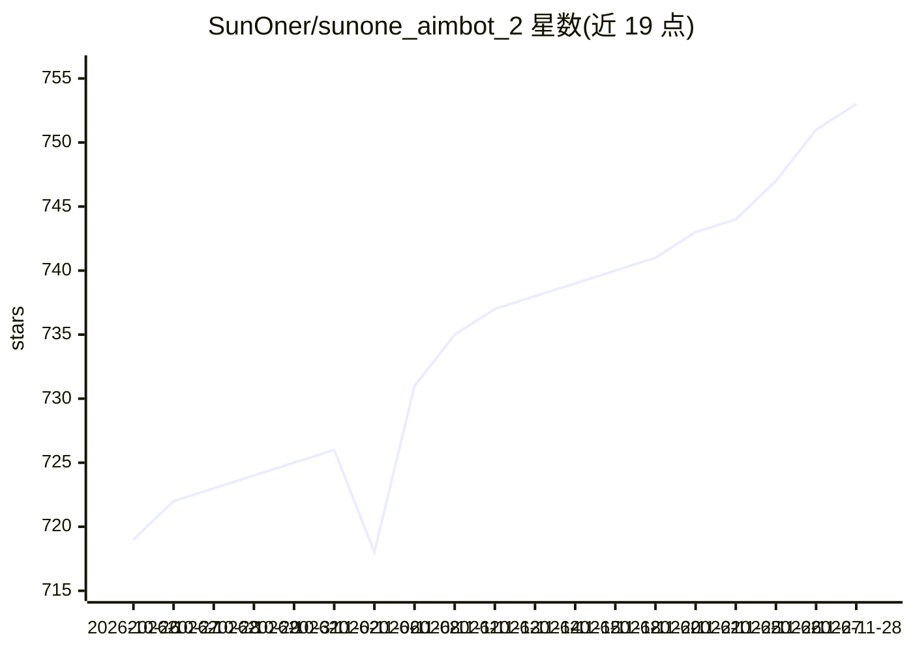

# SunOner/sunone_aimbot_2

⭐ 753 · C++ · NOASSERTION · 推送 2026-11-06 · [GitHub](https://github.com/SunOner/sunone_aimbot_2) · 个人维护

**面向 FPS/TPS 游戏的 AI 检测瞄准辅助程序**

基于 YOLO 检测模型的 C++ 瞄准辅助工具，实时读取游戏画面检测目标，右键触发瞄准；设置与模型选择通过 HOME 键呼出的 overlay 完成。提供预编译 exe（CUDA+NVIDIA 与 DirectML 全 GPU 两个版本），无需编译即可运行；也支持从源码构建。CUDA 版要求 NVIDIA 驱动与 CUDA 13.1，首次启动需导出模型（最长约 5 分钟），用户需自行放置 .onnx 模型。

## 筛选速览

| 维度 | 判定 | 备注 |
|---|---|---|
| AI 角色 | `ai-native` | 本体是模型或模型工具 |
| 许可风险 | `none` | NOASSERTION |
| 部署形态 | `desktop` | 安装包/桌面程序 |
| 模型依赖 | — | README 未给出锁定关系 |
| 硬件要求 | — | 无带数字的原话,不猜 |
| 安装摩擦 | `medium` | 含编译或系统依赖之一 |
| 成熟度 | — | 结构信号不足 |

## 能力要点

- 提供 CUDA 与 DirectML 双版本预编译 exe，直接下载运行
- DirectML 版支持 NVIDIA/AMD/Intel 含集成显卡的任意 GPU
- 支持放置 .onnx 模型并在 overlay 中选择
- 通过 KMBOX/MAKCU 等硬件链接的参考实现

## 适用场景

- 在无 CUDA 环境的 AMD/Intel 显卡电脑上运行检测
- 使用预编译包免编译快速上手
- 从源码构建 TensorRT 版本以配合 NVIDIA GPU

## 场景标签

`目标检测` · 领域:感知与多模态

## 证据(README 行号)

> L14: **You do NOT need to compile anything if you just want to use the aimbot!**
> L61: * **Right Mouse Button:** Aim at the detected target
> L55: 5. Place your `.onnx` model in the `models` folder and select it in the overlay (HOME key).

## 星数曲线

2026-10-26 719 → 2026-11-28 753（+34）

---
*卡片 v1 · prompt 1.4 · 生成 2026-11-24 · 置信度 high · 依据 README sha `5d63b56a3efc` · [字段定义](../../DATASET.md)*
