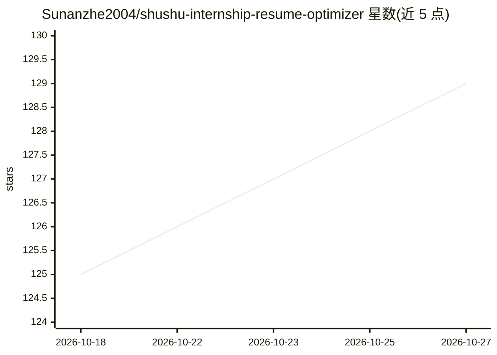

# Sunanzhe2004/shushu-internship-resume-optimizer

⭐ 129 · Python · NOASSERTION · 推送 2026-07-14 · [GitHub](https://github.com/Sunanzhe2004/shushu-internship-resume-optimizer) · 个人维护 · 中文 README

**把实习材料转成简历 bullet 与面试叙事的 AI 工具包**

面向求职者的实习材料整理工具：读取代码仓库、项目总结、业务文档与目标 JD，先做成果审计（证据、指标、职责边界、风险提醒），再按 JD 对成果排序，最后生成简历 bullet、项目总结、STAR 草稿、面试 Q&A 与投递前检查清单。采用 model-first, script-second 流程，脚本主要负责限额、排序与可读性复核，项目边界判断交给 skill/prompt 层。可选 doc_knowledge 做业务文档问答与检索。基于 Python >= 3.10，从源码安装运行，附最小示例输入。二次开发自 LiuMengxuan04/shushu-internship-tool。

## 筛选速览

| 维度 | 判定 | 备注 |
|---|---|---|
| AI 角色 | `ai-native` | 本体是模型或模型工具 |
| 许可风险 | `none` | NOASSERTION |
| 部署形态 | `library` | 以包/库形式分发 |
| 模型依赖 | — | README 未给出锁定关系 |
| 硬件要求 | — | 无带数字的原话,不猜 |
| 安装摩擦 | `low` | 无编译、无系统依赖或容器化 |
| 成熟度 | — | 结构信号不足 |

## 能力要点

- 三步主流程：achievement_audit → resume_rank → interview_pack
- 支持代码仓库、项目总结、业务文档多源输入与结构化抽取接入
- 按目标 JD 排序成果，标记 AI 味、夸大风险与待确认信息
- 生成 STAR 草稿、面试 Q&A 与投递前风险检查清单

## 适用场景

- 把散乱的实习记录整理成可投递的简历 bullet
- 按目标岗位 JD 排序并校准项目成果表达
- 准备面试用的 STAR 项目故事和追问 Q&A
- 检查简历表述中的夸大风险与证据缺口

## 场景标签

`AI 写作` · 领域:内容生成

## 证据(README 行号)

> L5: Shushu 会先审计成果与证据，再按目标 JD 排序，最后生成简历 bullet、项目总结、STAR 草稿、面试 Q&A 和风险检查清单。
> L103: `JD + 多源实习材料 -> achievement_audit -> resume_rank -> interview_pack`

## 星数曲线

2026-10-18 125 → 2026-10-27 129（+4）

---
*卡片 v1 · prompt 1.4 · 生成 2026-10-23 · 置信度 mid · 依据 README sha `08c847489ca9` · [字段定义](../../DATASET.md)*
