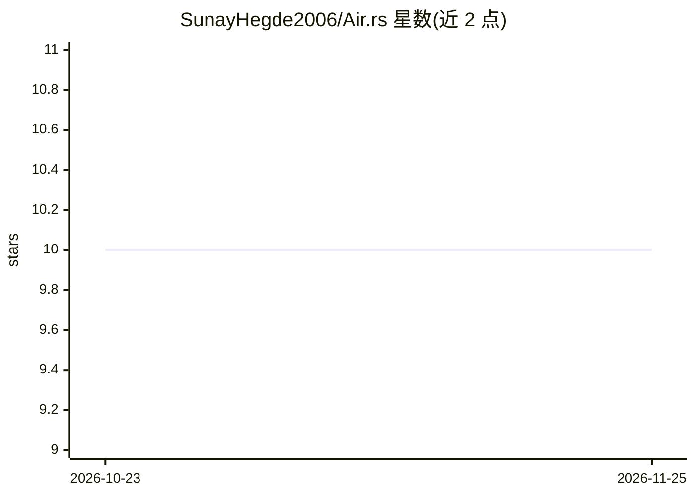

# SunayHegde2006/Air.rs

⭐ 10 · Rust · NOASSERTION · 推送 2026-10-10 · [GitHub](https://github.com/SunayHegde2006/Air.rs) · 个人维护

**面向本地 LLM 推理的零配置 Rust 推理引擎**

由 10 个 crate 组成的 Rust workspace，读取 GGUF 量化模型并生成推理结果：启动时自动检测硬件（CUDA/ROCm/Metal/WebGPU/CPU SIMD）并选择注意力与 GEMM 内核，量化权重在乘加阶段才反量化。提供 OpenAI 兼容 REST 服务、SSE 流式输出、CLI/TUI、C ABI 与 PyO3 Python 绑定；安装走 curl 一键脚本，也可用 nightly Rust 从源码构建。README 声明部分代码由 AI 工具辅助编写，建议用户自行评估后再部署。

## 筛选速览

| 维度 | 判定 | 备注 |
|---|---|---|
| AI 角色 | `ai-ecosystem` | LLM/agent 周边工具 |
| 许可风险 | `none` | NOASSERTION |
| 部署形态 | `library` | 以包/库形式分发 |
| 模型依赖 | — | README 未给出锁定关系 |
| 硬件要求 | — | 无带数字的原话,不猜 |
| 安装摩擦 | `high` | 编译与系统依赖俱全 |
| 成熟度 | `idea` | |

## 能力要点

- 自动检测硬件并运行时选择注意力/GEMM 内核，无需配置文件
- Paged KV cache（块大小 16）与 KIVI 4-bit 压缩支持长上下文
- OpenAI 兼容 REST 服务与 SSE 流式输出开箱即用
- 提供 CLI/TUI、C ABI 与 PyO3 Python 绑定三种接入形式

## 适用场景

- 在本地 GPU 或 Apple Silicon 上运行 GGUF 量化模型推理
- 通过 OpenAI 兼容 API 在本地托管模型服务
- 从 C/C++ 或 Python 程序内嵌推理引擎

## 场景标签

`推理引擎` · 领域:训练与推理

## 证据(README 行号)

> L14: Air.rs is a modular, 10-crate Rust workspace that provides inference for quantized large language models with zero 
> L20: - OpenAI-compatible REST server and SSE streaming out of the box
> L88: |`air-server`|`lib`|Axum REST server — `/v1/chat/completions`, `/v1/models`, SSE streaming|

## 星数曲线

2026-10-23 10 → 2026-11-25 10（+0）

---
*卡片 v1 · prompt 1.4 · 生成 2026-11-20 · 置信度 mid · 依据 README sha `a0eebc3e2723` · [字段定义](../../DATASET.md)*
