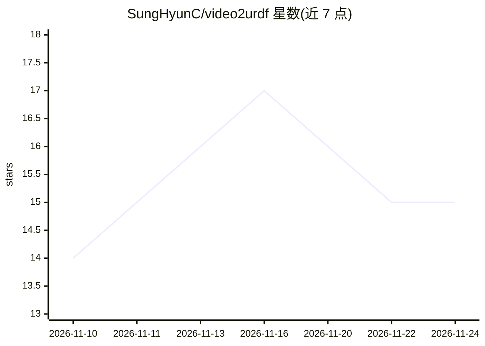

# SungHyunC/video2urdf

⭐ 15 · Python · MIT · 推送 2026-11-10 · [GitHub](https://github.com/SungHyunC/video2urdf) · [官网](https://sunghyunc.github.io/video2urdf/) · 个人维护

**从手机视频生成关节物体测量 URDF/MJDF 模型的工具**

面向需要真实关节物体仿真模型的机器人开发者：拍摄物体开合视频（可选 iPhone LiDAR），Muse Spark agent 调用 SAM 3.1 分割跟踪部件，最小二乘拟合各关节，写出 URDF 与 MJCF，并在 MuJoCo 中逐帧回放校验叠加效果；还含 Franka Panda 仿真操作演示与检查已有 URDF 的 URDF Doctor。运行时模型走 Meta Model API 或开放权重（Baseten/Fireworks/Modal），Mac/Linux 无需本地 GPU，需要 uv 与 ffmpeg。黑客松个人项目，含复现脚本与单元测试。

## 筛选速览

| 维度 | 判定 | 备注 |
|---|---|---|
| AI 角色 | `ai-native` | 本体是模型或模型工具 |
| 许可风险 | `permissive` | MIT |
| 部署形态 | `None` |  |
| 模型依赖 | — | README 未给出锁定关系 |
| 硬件要求 | — | 无带数字的原话,不猜 |
| 安装摩擦 | `medium` | 含编译或系统依赖之一 |
| 成熟度 | — | 结构信号不足 |

## 能力要点

- Muse Spark agent 驱动 SAM 3.1 分割跟踪并拟合关节
- MuJoCo 逐帧回放校验模型与视频叠加
- 支持开放权重路径（--open-weights / --glimmer）
- reproduce.py 无需 API key 即可复现已发布测量结果

## 适用场景

- 为真实关节物体（笔记本、台灯、抽屉）快速生成仿真模型
- 不用手工估铰链与限位，直接测量
- 核验已有 URDF 是否与视频中的物体运动一致

## 场景标签

 · 领域:机器人/计算机视觉

## 证据(README 行号)

> L22: it looks right. Video2URDF measures it instead. Film the object being opened and closed; a
> L23: Muse Spark agent finds the parts with SAM 3.1, tracks them, fits each joint by least squares,
> L50: Every model called at runtime is a Meta model; `--open-weights` runs the same pipeline on Muse

## 星数曲线

2026-11-10 14 → 2026-11-24 15（+1）

---
*卡片 v1 · prompt 1.4 · 生成 2026-11-18 · 置信度 high · 依据 README sha `6deb5f958cfa` · [字段定义](../../DATASET.md)*
