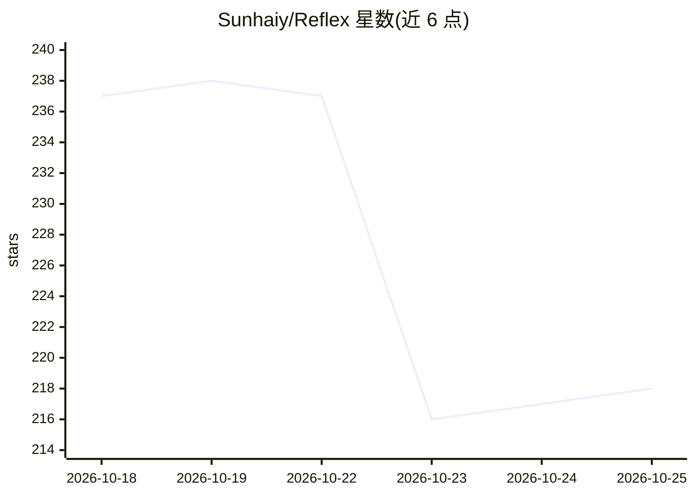

# Sunhaiy/Reflex

⭐ 218 · TypeScript · NOASSERTION · 推送 2026-10-21 · [GitHub](https://github.com/Sunhaiy/Reflex) · [官网](https://reflex.ink/) · 个人维护 · 中文 README

**跨平台 SSH 桌面客户端：终端/SFTP/Docker/监控加 AI Agent**

基于 Electron + React 的跨平台 SSH 桌面工作台：支持多连接多会话终端（密码/私钥/跳板机认证）、SFTP 文件管理、Docker 容器与镜像管理、CPU/内存/磁盘等硬件监控。内建 Agent 工作区，用自然语言执行服务器操作，展示可见的命令、工具输出与审批流程，可配置模型、provider、上下文预算与推理力度；连接配置与凭据存储在本地。提供 Windows/macOS/Linux 安装包，开发需 Node.js >=22.12.0。去掉 Agent 后 SSH/SFTP/Docker 功能仍独立可用。

## 筛选速览

| 维度 | 判定 | 备注 |
|---|---|---|
| AI 角色 | `ai-enhanced` | 去掉 AI 部分产品仍成立 |
| 许可风险 | `none` | NOASSERTION |
| 部署形态 | `None` |  |
| 模型依赖 | — | README 未给出锁定关系 |
| 硬件要求 | — | 无带数字的原话,不猜 |
| 安装摩擦 | `low` | 无编译、无系统依赖或容器化 |
| 成熟度 | — | 结构信号不足 |

## 能力要点

- 自然语言 Agent 执行服务器操作，带敏感命令审批与可见工具输出
- 多 SSH 会话、跳板机认证、会话状态跨任务切换可恢复
- SFTP 文件管理与 Docker 容器/镜像/日志管理
- 本地存储连接配置与 provider 凭据

## 适用场景

- 在一个桌面应用里同时用终端、文件管理和 Docker 操作服务器
- 用自然语言让 Agent 执行并审批服务器运维命令
- 远程监控服务器的 CPU、内存、磁盘与进程

## 场景标签

`AI 助手` · 领域:对话与助手

## 证据(README 行号)

> L34: **Reflex** is a cross-platform SSH desktop client built around real server work: connect, inspect, edit, deploy, re
> L87: - Natural-language server operations with visible progress and tool output
> L71: - **Agent-native execution:** describe an outcome and follow the visible commands, progress, approvals, and results

## 星数曲线

2026-10-18 237 → 2026-10-25 218（-19）

---
*卡片 v1 · prompt 1.4 · 生成 2026-10-22 · 置信度 high · 依据 README sha `b161843c610b` · [字段定义](../../DATASET.md)*
