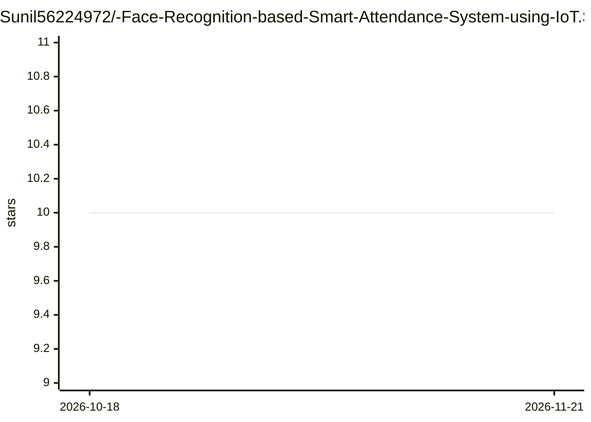

# Sunil56224972/-Face-Recognition-based-Smart-Attendance-System-using-IoT.Sunil

⭐ 10 · C · 推送 2026-05-09 · [GitHub](https://github.com/Sunil56224972/-Face-Recognition-based-Smart-Attendance-System-using-IoT.Sunil) · 个人维护

**ESP32-CAM+OpenCV 实时人脸识别考勤系统**

基于 ESP32-CAM 摄像头模块与 OpenCV 的考勤系统：摄像头通过 WiFi 传输画面，Python 端读取视频流并检测人脸，将识别到的姓名自动写入 CSV 考勤文件。用户需预先在 img_fol 文件夹上传注册人像，通过 Arduino IDE 刷写 ESP32 固件（需配置 WiFi、板型、分区方案等参数），运行 Attendance.py 后按 q 退出。

## 筛选速览

| 维度 | 判定 | 备注 |
|---|---|---|
| AI 角色 | `ai-native` | 本体是模型或模型工具 |
| 许可风险 | `none` | — |
| 部署形态 | `None` |  |
| 模型依赖 | — | README 未给出锁定关系 |
| 硬件要求 | — | 无带数字的原话,不猜 |
| 安装摩擦 | `low` | 无编译、无系统依赖或容器化 |
| 成熟度 | — | 结构信号不足 |

## 能力要点

- ESP32-CAM 经 WiFi 提供实时视频流
- OpenCV 人脸检测并显示识别到的姓名
- 考勤结果自动记录到 CSV 文件
- 提供 Arduino Uno 与 FTDI 两种接线方案

## 适用场景

- 课堂或会议自动记录出勤
- 避免人工点名/手动标记签到

## 场景标签

`人脸识别` · 领域:感知与多模态

## 证据(README 行号)

> L2: Face Recognition using ESP-32 Camera Module and OpenCV
> L52:  Run the python file and the name will start displaying below in the terminal whenever your face is detected by the

## 星数曲线

2026-10-18 10 → 2026-11-21 10（+0）

---
*卡片 v1 · prompt 1.4 · 生成 2026-11-20 · 置信度 high · 依据 README sha `237839040e7b` · [字段定义](../../DATASET.md)*
