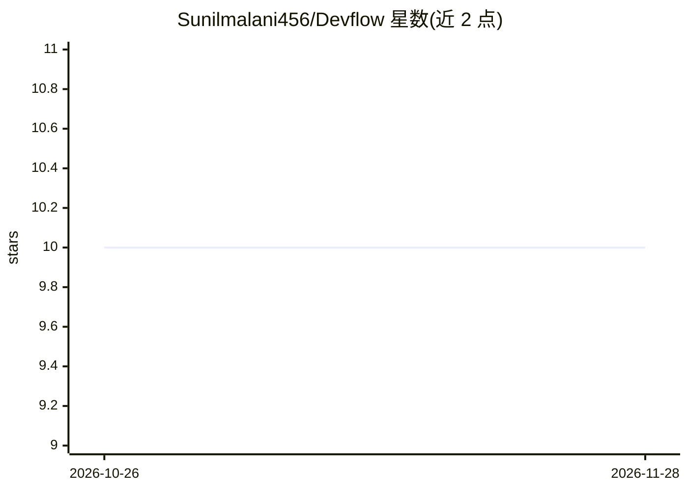

# Sunilmalani456/Devflow

⭐ 10 · TypeScript · 推送 2025-12-16 · [GitHub](https://github.com/Sunilmalani456/Devflow) · [官网](https://devflow-sunils-projects-56afcfa3.vercel.app/) · 个人维护

**开发者问答平台项目：提问、分享知识、互相学习**

基于 Next.js 14 构建的开发者问答（Q&A）Web 应用，技术栈包括 TypeScript、Tailwind CSS、Clerk 认证、MongoDB/Mongoose、Shadcn-UI、TinyMCE 富文本编辑等。集成 OpenAI API 与 RapidAPI 的 JSearch API，需配置多个外部服务账号的密钥方可运行。README 给出本地开发、生产构建及 Vercel/Netlify 部署步骤，项目源自 JavaScript Mastery 的 Next.js 14 课程，以 MIT 许可开源。

## 筛选速览

| 维度 | 判定 | 备注 |
|---|---|---|
| AI 角色 | `ai-enhanced` | 去掉 AI 部分产品仍成立 |
| 许可风险 | `none` | — |
| 部署形态 | `library` | 以包/库形式分发 |
| 模型依赖 | — | README 未给出锁定关系 |
| 硬件要求 | — | 无带数字的原话,不猜 |
| 安装摩擦 | `low` | 无编译、无系统依赖或容器化 |
| 成熟度 | — | 结构信号不足 |

## 能力要点

- 开发者问答平台：提问、回答、知识分享
- Clerk 认证与 webhook 用户同步
- 集成 OpenAI API 与 JSearch（RapidAPI）
- 提供 Vercel/Netlify 部署指引与在线演示

## 适用场景

- 搭建开发者社区问答站点
- 学习 Next.js 14 全栈项目结构与实践
- 参考 Clerk + MongoDB + Next.js 的集成方式

## 场景标签

`教程课程` · 领域:学习与行业

## 证据(README 行号)

> L15: **DevOverflow** is a complex Q&A platform for developers to ask questions, share knowledge, and learn from each oth
> L75: > - the application uses OpenAI API, therefore, you need to create OpenAI account here and sets the `OPENAI_API_KEY

## 星数曲线

2026-10-26 10 → 2026-11-28 10（+0）

---
*卡片 v1 · prompt 1.4 · 生成 2026-11-20 · 置信度 high · 依据 README sha `03d7cfd16186` · [字段定义](../../DATASET.md)*
