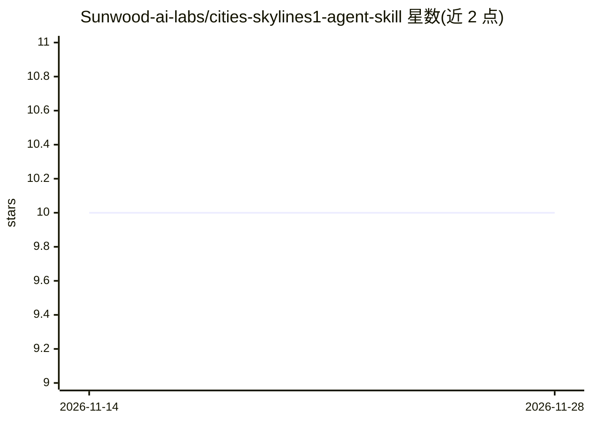

# Sunwood-ai-labs/cities-skylines1-agent-skill

⭐ 10 · C# · MIT · 推送 2026-11-17 · [GitHub](https://github.com/Sunwood-ai-labs/cities-skylines1-agent-skill) · [官网](https://sunwood-ai-labs.github.io/cities-skylines1-agent-skill/) · 组织维护

**让 AI agent 通过本地 API 检查、修建与维护 Cities: Skylines 1 城市的 mod 与 skill**

由两部分组成：一个监听 127.0.0.1:32123 的 Cities: Skylines 1 mod，把城市状态（问题、设施、路网、分区异常、存档等）暴露为本地 REST API，并提供修路、放置建筑、划区、调速、存档等命令 API；同时以 SKILL.md 形式打包为 Codex skill，指导 agent 调用这些接口。定位为替代截图感知城市状态的方案，明确标注为实验性质、仅支持 Windows，建议先在丢弃存档上测试。

## 筛选速览

| 维度 | 判定 | 备注 |
|---|---|---|
| AI 角色 | `ai-enhanced` | 去掉 AI 部分产品仍成立 |
| 许可风险 | `permissive` | MIT |
| 部署形态 | `None` |  |
| 模型依赖 | — | README 未给出锁定关系 |
| 硬件要求 | — | 无带数字的原话,不猜 |
| 安装摩擦 | `low` | 无编译、无系统依赖或容器化 |
| 成熟度 | `idea` | |

## 能力要点

- 通过本地 REST API 读取城市状态（health/summary/problems/saves 等 14 个端点）
- 提供 bulldoze、build-network、set-zone、set-tax-rate 等命令 API，含 batch 包装器
- 游戏内常驻控制台显示带时间戳的 API 调用记录
- 以 SKILL.md + agents/openai.yaml 形式作为 Codex skill 分发

## 适用场景

- 让 Codex agent 自动检查并修复城市道路异常
- 脚本化批量放置建筑、划区并保存城市
- 读取城市经济、设施、路网数据用于分析或实验

## 场景标签

`GUI 自动化` · 领域:效率与自动化

## 证据(README 行号)

> L5:  Codex skill and Cities: Skylines 1 mod for API-driven city inspection, repair, building, zoning, and saving.
> L24: - Runs a CS1 mod that listens on `http://127.0.0.1:32123`.
> L132: This repository is also a Codex skill. The root SKILL.md tells an agent how to operate CS1 through this bridge.

## 星数曲线

2026-11-14 10 → 2026-11-28 10（+0）

---
*卡片 v1 · prompt 1.4 · 生成 2026-11-20 · 置信度 high · 依据 README sha `7a47bbd089d0` · [字段定义](../../DATASET.md)*
