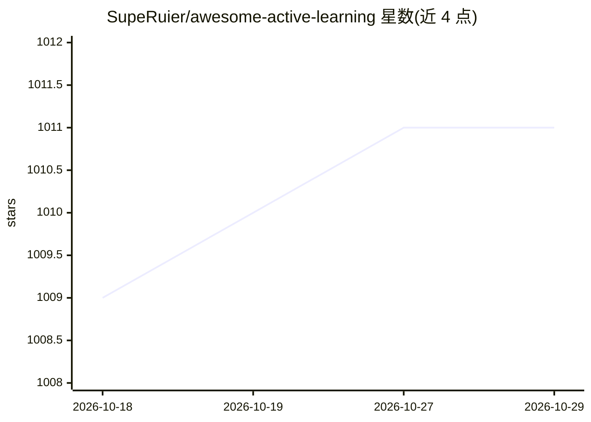

# SupeRuier/awesome-active-learning

⭐ 1,011 · 推送 2026-03-16 · [GitHub](https://github.com/SupeRuier/awesome-active-learning) · 个人维护 · 中文 README

**主动学习研究资料库：论文、综述、工具与学者索引**

面向机器学习研究者的主动学习（Active Learning）策展资料库：按出处（会议/期刊/学位论文）与问题导向两种方式组织论文列表，收录综述、教程、基准，梳理基础问题场景（pool-based/stream-based/query synthesis）、高级设定与在 CV/NLP/强化学习等领域的应用，并列出 13 个代码工具包与活跃学者名录。README 中英双语，理论章节与部分章节标注未完成，通过 pull request 接受社区贡献。

## 筛选速览

| 维度 | 判定 | 备注 |
|---|---|---|
| AI 角色 | `ai-knowledge` | 知识聚合/清单类 |
| 许可风险 | `none` | — |
| 部署形态 | `None` |  |
| 模型依赖 | — | README 未给出锁定关系 |
| 硬件要求 | — | 无带数字的原话,不猜 |
| 安装摩擦 | `low` | 无编译、无系统依赖或容器化 |
| 成熟度 | — | 结构信号不足 |

## 能力要点

- 按会议/期刊/学位论文与问题导向双维度组织论文列表
- 收录 15 篇综述、4 个基准与教程讲义
- 梳理三类基础问题场景与多标签/多任务等高级设定
- 收录 13 个主动学习代码库及学者/团队名录

## 适用场景

- 系统查找主动学习方向的综述与论文
- 选择适合自己任务的主动学习代码库
- 了解主动学习的学者团队与研究前沿

## 场景标签

`精选清单` `教程课程` · 领域:学习与行业

## 证据(README 行号)

> L11:  Everything you need about Active Learning (AL).
> L12:  Not only a curated list, but also a well-structured library.

## 星数曲线

2026-10-18 1,009 → 2026-10-29 1,011（+2）

---
*卡片 v1 · prompt 1.4 · 生成 2026-10-21 · 置信度 high · 依据 README sha `f10b1b78c9c4` · [字段定义](../../DATASET.md)*
