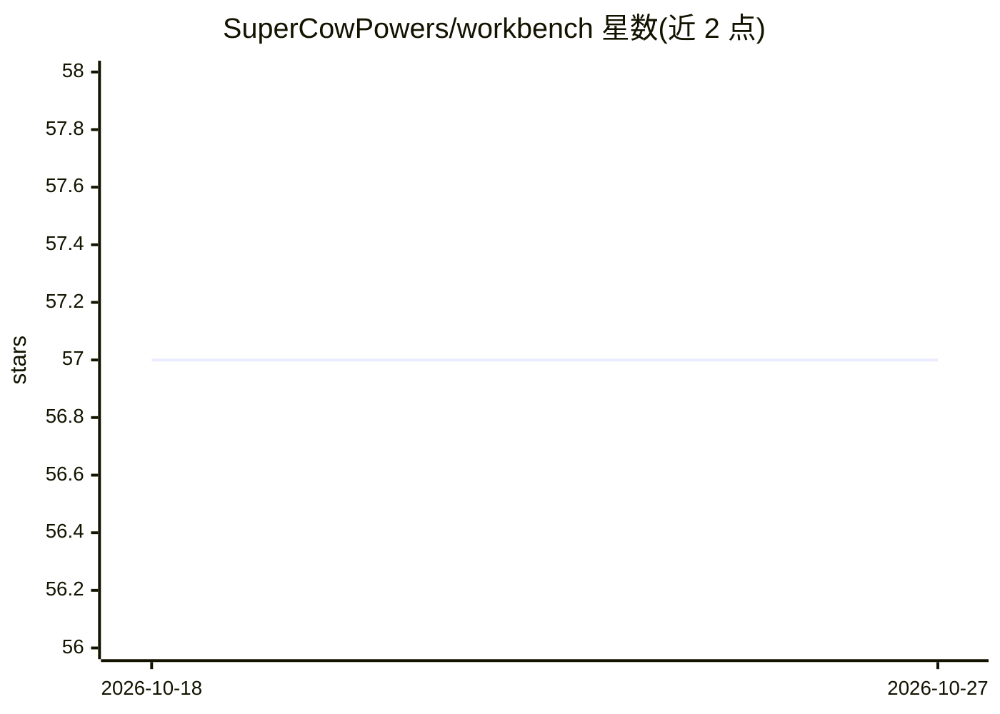

# SuperCowPowers/workbench

⭐ 57 · Python · MIT · 推送 2026-10-26 · [GitHub](https://github.com/SuperCowPowers/workbench) · [官网](https://www.supercowpowers.com) · 组织维护

**面向 AWS SageMaker 的 Python ML 流水线 API 与部署框架**

SuperCowPowers 团队维护的 Python 框架，在 AWS Glue、Athena、Feature Store、Models 与 Endpoints 之上提供统一 API，覆盖 DataSource→FeatureSet→Model→Endpoint 全链路，并附带 Web Dashboard 监控。内置 ML agent 'Bosco'，支持自然语言构建模型，可通过 Anthropic API key 或 AWS Bedrock 接入 Claude。支持本地模式（无需 AWS 账号即可训练）与 BYOC 私有部署；面向 Open ADMET 挑战支持多种 Chemprop 分子性质预测模型。

## 筛选速览

| 维度 | 判定 | 备注 |
|---|---|---|
| AI 角色 | `ai-ecosystem` | LLM/agent 周边工具 |
| 许可风险 | `permissive` | MIT |
| 部署形态 | `library` | 以包/库形式分发 |
| 模型依赖 | locked-api |  |
| 硬件要求 | — | 无带数字的原话,不猜 |
| 安装摩擦 | `low` | 无编译、无系统依赖或容器化 |
| 成熟度 | `idea` | |

## 能力要点

- 统一 Python API 封装 Glue/Athena/Feature Store/Models/Endpoints 全链路
- 本地模式无需 AWS 账号，使用与 SageMaker 相同的训练脚本
- ML agent Bosco 支持自然语言与 Python 混合交互
- 支持单任务/多任务/描述符/基础模型四类 Chemprop 模型

## 适用场景

- 在 AWS 上构建并部署端到端 ML 流水线
- 药物发现场景训练与部署 ADMET 溶解度等分子性质模型
- 通过 Dashboard 监控 ML 流水线各环节状态

## 场景标签

`MLOps` · 领域:训练与推理

## 证据(README 行号)

> L92: The ADMET Workbench framework makes AWS® both easier to use and more powerful: a simple
> L17: **No AWS account needed to start.** Local mode gives you the whole chain —

## 星数曲线

2026-10-18 57 → 2026-10-27 57（+0）

---
*卡片 v1 · prompt 1.4 · 生成 2026-10-24 · 置信度 high · 依据 README sha `ea3436bc53e6` · [字段定义](../../DATASET.md)*
