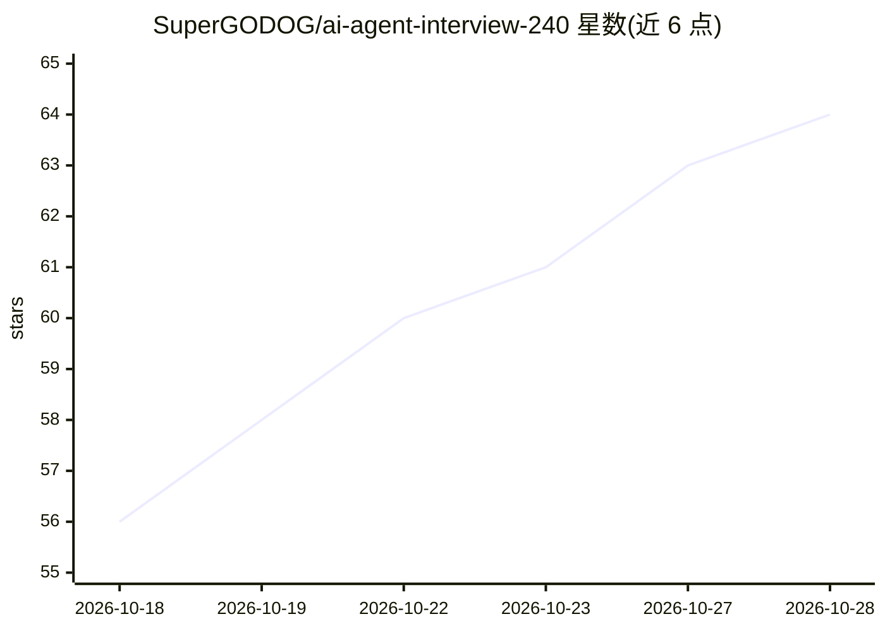

# SuperGODOG/ai-agent-interview-240

⭐ 64 · Python · MIT · 推送 2026-10-24 · [GitHub](https://github.com/SuperGODOG/ai-agent-interview-240) · 个人维护 · 中文 README

**AI Agent 岗面试题库：477 道真题 + 语言八股 + 项目档案**

面向大模型 Agent 岗求职者的面试准备资料库：477 道公共面试题（本仓库静态保留首批 240 道，含答题框架与 1-5 级深度标注）、85 篇 Java/Python/Go 语言八股、2 个主线项目档案（SkillForge 与 miaosha 秒杀系统），以及可安装到 AI 助手的模拟面试 Skill 包（出题→作答→四维点评）。动态题库由 interview-mock-skill 统一维护，本仓库为介绍与首批静态文档壳；另含 420 张独立 schema 的 agent-review-audit 审查题卡。题源为作者面试经历与公开渠道搜集。

## 筛选速览

| 维度 | 判定 | 备注 |
|---|---|---|
| AI 角色 | `ai-knowledge` | 知识聚合/清单类 |
| 许可风险 | `permissive` | MIT |
| 部署形态 | `None` |  |
| 模型依赖 | — | README 未给出锁定关系 |
| 硬件要求 | — | 无带数字的原话,不猜 |
| 安装摩擦 | `medium` | 含编译或系统依赖之一 |
| 成熟度 | — | 结构信号不足 |

## 能力要点

- 477 道公共面试题，每题带四步答题框架与前置/后置学习路径
- 85 篇 Java/Python/Go 语言八股（含 66 篇体系化课件）
- 可安装到 Claude Code 等 AI 助手的模拟面试 Skill 包（大厂模拟面试官 + 项目拷问引擎）
- 每题 1-5 级深度分级，按梯度刷题

## 适用场景

- 准备大厂 AI Agent 岗与后端开发岗面试
- 按深度梯度系统刷 Agent 应用开发与语言八股
- 用 AI 助手进行模拟面试与项目拷问练习

## 场景标签

`教程课程` · 领域:学习与行业

## 证据(README 行号)

> L1: # 🎯 AI Agent 面试真题库 · 477 道公共题库
> L15: - 🏆 **477 道公共真题**：完整题库由 interview-mock-skill 统一维护；本仓库当前保留首批 240 道五卷文档，扩展题与首批题属于同一题库、权重相同，新增部分更侧重秒杀、Redis、MQ、MySQL 等
> L64: - **公共题库**：当前由 interview-mock-skill 统一维护，共 477 道题；六件套 Skill 共享同一份题库，首批 240 道与后续扩展题权重相同，只是新增部分更侧重后端。

## 星数曲线

2026-10-18 56 → 2026-10-28 64（+8）

---
*卡片 v1 · prompt 1.4 · 生成 2026-10-24 · 置信度 high · 依据 README sha `a09dd2880d16` · [字段定义](../../DATASET.md)*
