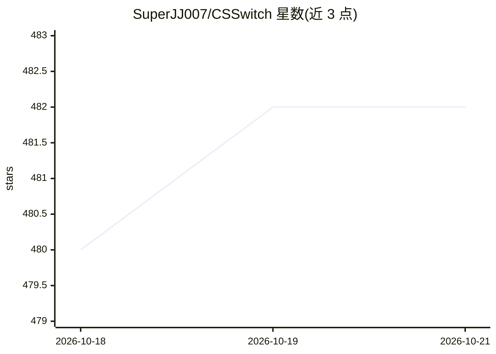

# SuperJJ007/CSSwitch

⭐ 485 · Rust · MIT · 推送 2026-08-22 · [GitHub](https://github.com/SuperJJ007/CSSwitch) · 个人维护 · 中文 README

**macOS 菜单栏工具：让 Claude Science 接入第三方模型 API**

面向 macOS Apple Silicon 用户的桌面应用，基于 Tauri 2 构建，用于让 Claude Science 使用用户自己的模型 API：内置 DeepSeek、通义千问、智谱 GLM、Kimi、MiniMax、OpenRouter 等 Provider，也支持任意 OpenAI/Anthropic 兼容自定义端点，并在配置间一键切换。第三方模式使用独立 HOME 与本地回环 Gateway，隔离真实 Claude 登录数据；API Key 以 0600 权限保存在本机。另提供 Skill 导入与从 GitHub 安装（含安全校验）、Codex 实验入口；通用 MCP 管理尚未支持。安装方式为下载 dmg 拖入应用程序。

## 筛选速览

| 维度 | 判定 | 备注 |
|---|---|---|
| AI 角色 | `ai-ecosystem` | LLM/agent 周边工具 |
| 许可风险 | `permissive` | MIT |
| 部署形态 | `desktop` | 安装包/桌面程序 |
| 模型依赖 | locked-api |  |
| 硬件要求 | — | 无带数字的原话,不猜 |
| 安装摩擦 | `low` | 无编译、无系统依赖或容器化 |
| 成熟度 | `idea` | |

## 能力要点

- 内置 12 类 Provider 与 OpenAI/Anthropic 兼容自定义端点，严格映射模型不静默切换
- 独立 HOME、data-dir 与本地回环 Gateway 隔离真实 Claude 登录与 Science 数据
- Skill 查看、本地包导入与 GitHub URL 安全安装（大小/路径穿越/符号链接校验）
- Codex 独立浏览器登录与动态账号模型目录（实验功能，默认关闭）

## 适用场景

- 让 Claude Science 使用 DeepSeek、通义千问等自己的 API Key 和模型
- 在官方 Claude 账号与第三方模型之间快速切换
- 把本地或 GitHub 上的 Skill 安全接入隔离的 Science 环境

## 场景标签

`模型网关` · 领域:Agent 开发

## 证据(README 行号)

> L15:  CSSwitch 让 Claude Science 接入你自己的模型 API。
> L79: - **内置 Provider：** DeepSeek、通义千问、智谱 GLM、小米 MiMo、硅基流动、Kimi、MiniMax、OpenRouter、OpenCode Go（OpenAI Chat / Anthropic Me
> L105: - 第三方模式使用独立 HOME、data-dir 和本地回环 Gateway，不读取或修改真实 Claude 登录与 Science 数据。

## 星数曲线

2026-10-18 480 → 2026-10-21 482（+2）

---
*卡片 v1 · prompt 1.4 · 生成 2026-10-22 · 置信度 mid · 依据 README sha `b37d2113f772` · [字段定义](../../DATASET.md)*
