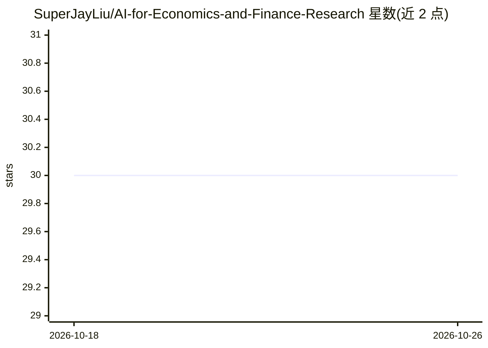

# SuperJayLiu/AI-for-Economics-and-Finance-Research

⭐ 30 · HTML · MIT · 推送 2026-08-24 · [GitHub](https://github.com/SuperJayLiu/AI-for-Economics-and-Finance-Research) · [官网](https://www.chaojieliu.com) · 个人维护 · 中文 README

**面向经济与金融研究的 AI/LLM 使用手册与技能库**

GitHub 原生的实用手册与资源库，指导经济学与金融学研究者负责任地使用 AI/LLM：涵盖概念学习、可复制的提示词/技能、Git/GitHub/agent 安全设置、文献综述、论文写作、实证方法、数据清洗、系统综述与教学材料六大板块。提供 skill-pack（SKILL.md）可将整个仓库作为一个 AI 技能加入 ChatGPT/Claude/Codex 类工具；强调读者验证 AI 输出并记录 AI 使用。附 SSRN 工作论文版本，中英双语。

## 筛选速览

| 维度 | 判定 | 备注 |
|---|---|---|
| AI 角色 | `ai-knowledge` | 知识聚合/清单类 |
| 许可风险 | `permissive` | MIT |
| 部署形态 | `None` |  |
| 模型依赖 | — | README 未给出锁定关系 |
| 硬件要求 | — | 无带数字的原话,不猜 |
| 安装摩擦 | `low` | 无编译、无系统依赖或容器化 |
| 成熟度 | — | 结构信号不足 |

## 能力要点

- 六大工作板块：手册、技能复制、agent/Git 设置、案例、数据源核查、教学分享
- skill-pack 可将整个仓库打包为一个 AI 技能导入 ChatGPT/Claude/Codex 类工具
- 按角色（新博士生/RA/教职/金融研究者）与任务关键词提供导航路径
- 有对应 SSRN 工作论文，仓库版本 v1.0.1

## 适用场景

- 作为博士生或 RA 学习 AI 辅助经济金融研究的入门手册
- 复制文献综述、论文写作、实证方法等现成提示词技能到 AI 工具中使用
- 为课题组搭建带审批门槛与 AI 使用日志的 Git/agent 协作流程

## 场景标签

`提示工程` `金融量化` `科研工具` `教程课程` · 领域:Agent 开发

## 证据(README 行号)

> L3: A practical, GitHub-native handbook and resource library for using AI responsibly in economics and finance research.
> L12: > To use this repository as one AI skill for a real research project, open `skill-pack/`. It gives step-by-step gui
> L34: |Copy a usable skill|02 Copy One Usable Skill|one prompt/instruction you can paste into an AI tool today|

## 星数曲线

2026-10-18 30 → 2026-10-26 30（+0）

---
*卡片 v1 · prompt 1.4 · 生成 2026-10-26 · 置信度 high · 依据 README sha `4b12069b38ad` · [字段定义](../../DATASET.md)*
