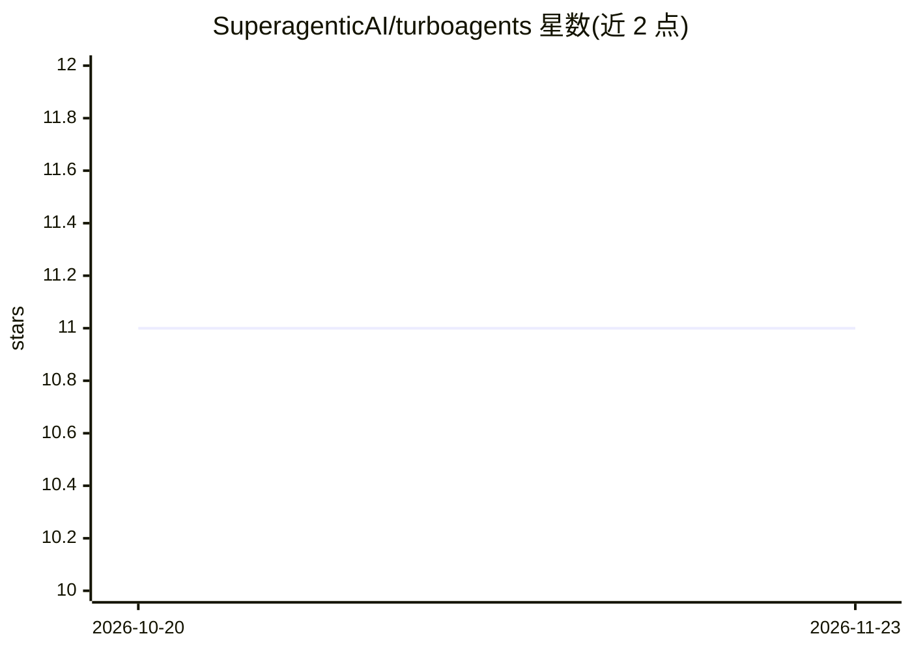

# SuperagenticAI/turboagents

⭐ 11 · Python · NOASSERTION · 推送 2026-09-04 · [GitHub](https://github.com/SuperagenticAI/turboagents) · [官网](https://super-agentic.ai/turboagents) · 组织维护

**为现有 Agent 与 RAG 栈提供 KV-cache/向量压缩的基础设施库**

turboagents 是一个 Python 包，提供 TurboQuant 风格的 KV-cache 与向量压缩，定位为置于现有 AI 系统之下的压缩层而非替代方案：为 MLX/llama.cpp/vLLM 推理路径提供引擎封装，为 Chroma/FAISS/LanceDB/SurrealDB/pgvector 检索后端提供压缩重排适配器，并内置 CLI 基准工具测量载荷体积、重建质量与召回率。面向已有 agent/RAG 系统的开发者团队。README 明确说明长上下文能力有限：Needle 测试仅覆盖早期位置检索。安装采用 uv/PyPI 分发。

## 筛选速览

| 维度 | 判定 | 备注 |
|---|---|---|
| AI 角色 | `ai-ecosystem` | LLM/agent 周边工具 |
| 许可风险 | `none` | NOASSERTION |
| 部署形态 | `library` | 以包/库形式分发 |
| 模型依赖 | local-ok | 支持本地模型 |
| 硬件要求 | — | 无带数字的原话,不猜 |
| 安装摩擦 | `low` | 无编译、无系统依赖或容器化 |
| 成熟度 | `idea` | |

## 能力要点

- KV-cache 与向量载荷的 TurboQuant 风格压缩（Walsh-Hadamard 旋转、PolarQuant 角度/半径、QJL 残差 sketch）
- MLX/llama.cpp/vLLM（实验性）三种推理引擎封装
- Chroma/FAISS/LanceDB/SurrealDB/pgvector 五种检索后端适配器
- 内置 CLI 基准工具与已验证的召回率基准数据

## 适用场景

- 为长 prompt 下内存吃紧的 agent 系统压缩 KV-cache
- 在现有 RAG 向量库之上加一层压缩重排
- 在改动应用代码前用基准 CLI 评估压缩对质量/召回的影响

## 场景标签

`模型量化` · 领域:训练与推理

## 证据(README 行号)

> L18: **Compression Infrastructure For Agent Runtimes And Retrieval Stacks**
> L21: compression. It is designed to sit underneath existing AI systems, not replace
> L129: `turboagents` is not an agent framework. It is the compression layer you put

## 星数曲线

2026-10-20 11 → 2026-11-23 11（+0）

---
*卡片 v1 · prompt 1.4 · 生成 2026-11-18 · 置信度 high · 依据 README sha `2fd21a2c9bdf` · [字段定义](../../DATASET.md)*
