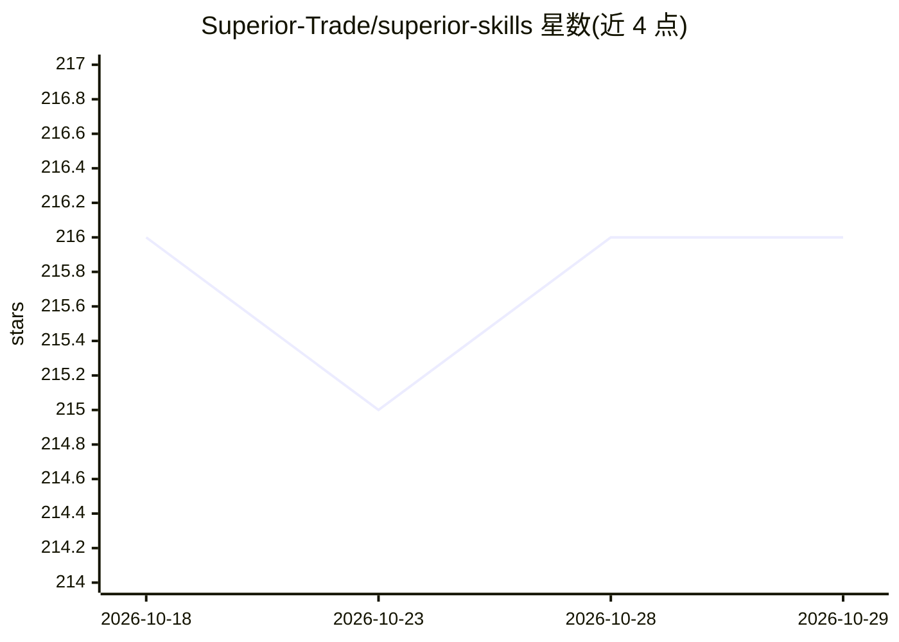

# Superior-Trade/superior-skills

⭐ 216 · JavaScript · MIT · 推送 2026-09-10 · [GitHub](https://github.com/Superior-Trade/superior-skills) · 组织维护

**面向交易 agent 的技能与工具模式包：Hyperliquid 回测部署**

为 Superior Trade 平台及 OpenClaw 类 agent 提供的交易技能与工具模式集合：以 superior-trade 入口技能串联 API key、账户、注资、策略选择、回测到实盘部署的全流程，再分发到各交易场所（Hyperliquid、Lighter、Polymarket、Aerodrome）子技能。包含 2 个带 162 天真实数据回测证据的验证策略、8 个模板策略、6 类可组合原语（如三重确认机制门控、三阶段出场引擎），并附旧版 API 到 Unified API 的迁移对照表。

## 筛选速览

| 维度 | 判定 | 备注 |
|---|---|---|
| AI 角色 | `ai-ecosystem` | LLM/agent 周边工具 |
| 许可风险 | `permissive` | MIT |
| 部署形态 | `library` | 以包/库形式分发 |
| 模型依赖 | — | README 未给出锁定关系 |
| 硬件要求 | — | 无带数字的原话,不猜 |
| 安装摩擦 | `low` | 无编译、无系统依赖或容器化 |
| 成熟度 | — | 结构信号不足 |

## 能力要点

- 入口技能串联从开户到实盘部署的完整路径
- 2 个带真实 Hyperliquid 数据回测证据的验证策略（Donchian 强趋势 + 布林回归）
- 8 个模板策略覆盖趋势、均值回归、套利、高频等类别
- Unified API 迁移对照表与 OpenAPI 快照、端点审计

## 适用场景

- 给 OpenClaw agent 添加交易与回测能力
- 复用经过回测验证的策略模板部署到 Hyperliquid
- 将旧版本 Superior Trade 技能迁移到 Unified API

## 场景标签

`金融量化` `Agent 框架` · 领域:Agent 开发

## 证据(README 行号)

> L5: Designed for OpenClaw users adding trading capabilities to their agent, and for traders who want validated templates
> L11: `superior-trade` is the entry skill. It carries the whole path — API key, trading account, funding, strategy select

## 星数曲线

2026-10-18 216 → 2026-10-29 216（+0）

---
*卡片 v1 · prompt 1.4 · 生成 2026-10-22 · 置信度 low · 依据 README sha `19724c4a85ab` · [字段定义](../../DATASET.md)*
