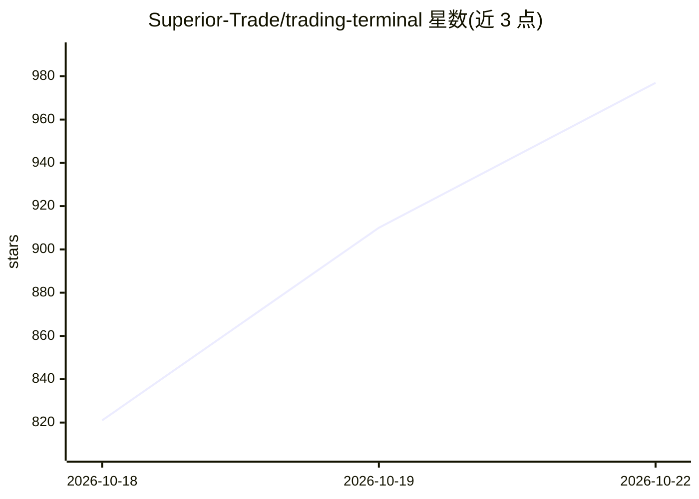

# Superior-Trade/trading-terminal

⭐ 1,005 · TypeScript · Apache-2.0 · 推送 2026-10-09 · [GitHub](https://github.com/Superior-Trade/trading-terminal) · [官网](https://terminal.superior.trade) · 组织维护

**面向 Hyperliquid 的自托管 AI 交易终端：图表手绘预测生成可执行策略**

AI 交易终端，面向 Hyperliquid 交易者。用户在图表上绘制趋势线/区域等预测，agent 读取绘图、可见范围、指标与截图，返回带入场/止损/目标的排序交易方案；选定后生成 Freqtrade 策略代码，经确定性安全校验（如禁止 shift(-N) 前视、止损随杠杆缩放检查）与自动修复循环，再进行历史回测并实盘部署（bracket 订单、杠杆上限、限时自动止损）。自托管版本内嵌 Postgres、无登录、密钥留在本机；需 Superior Trade API 与 OpenRouter 两个 key。内置 Lightweight Charts，TradingView Advanced Charts 需另行申请。

## 筛选速览

| 维度 | 判定 | 备注 |
|---|---|---|
| AI 角色 | `ai-native` | 本体是模型或模型工具 |
| 许可风险 | `permissive` | Apache-2.0 |
| 部署形态 | `library` | 以包/库形式分发 |
| 模型依赖 | locked-api |  |
| 硬件要求 | — | 无带数字的原话,不猜 |
| 安装摩擦 | `low` | 无编译、无系统依赖或容器化 |
| 成熟度 | — | 结构信号不足 |

## 能力要点

- agent 读取图表手绘与截图，生成带入场/止损/目标/失效位的排序交易方案
- Freqtrade 策略生成 + 确定性安全校验与自动修复循环
- 实盘部署：bracket 订单、仓位管理、杠杆上限、限时自动止损
- 自托管：内嵌 Postgres、无登录、提示词可编辑

## 适用场景

- 在图表上画出我对走势的判断，让 agent 生成完整交易计划
- 把选定的方案转成 Freqtrade 策略并实盘部署到 Hyperliquid
- 自托管运行，交易密钥与提示词全部留在本机

## 场景标签

`金融量化` · 领域:学习与行业

## 证据(README 行号)

> L5: An AI trading terminal for Hyperliquid. Sketch your read straight onto the chart; the
> L55: **3. You say deploy.** It writes the strategy, and the validator reads it before
> L114: |**Strategies**|Freqtrade code generation, deterministic safety validation, automatic repair, historical backtests

## 星数曲线

2026-10-18 821 → 2026-10-22 977（+156）

---
*卡片 v1 · prompt 1.4 · 生成 2026-10-21 · 置信度 high · 依据 README sha `d7aac7b71ad3` · [字段定义](../../DATASET.md)*
