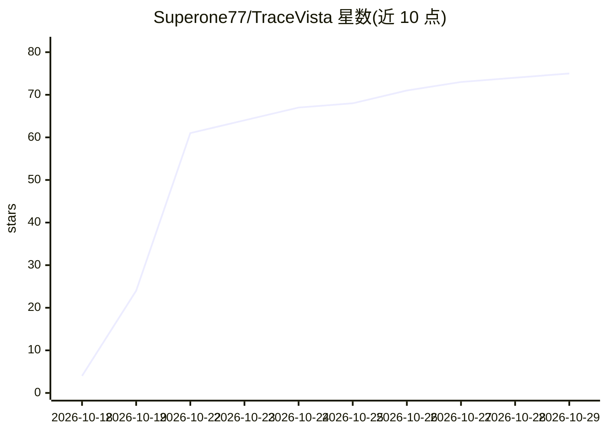

# Superone77/TraceVista

⭐ 75 · TypeScript · MIT · 推送 2026-10-23 · [GitHub](https://github.com/Superone77/TraceVista) · [官网](https://tracevista.pages.dev/) · 个人维护 · 中文 README

**把 agent 运行日志变成可交互决策地图与回放故事的查看器**

面向编码、研究与创作工作流的 agent 轨迹可视化工具：读取 Claude Code、Codex、Pi 会话日志及 InferenceBench、SWE-rebench OpenHands 轨迹，通过一个 tracevista-skill 转换为 .agent-state.json，在 React Flow 查看器中按系统状态→工作阶段→动作→原始记录四层展开，提供版本树、执行顺序、决策标记、播放回放与带引用溯源的上下文问答（可接入多种 API 或 Ollama/LM Studio 本地模型）。原始记录逐字保留以供核对。本地运行需 Node.js 24+ 与 pnpm 11+，转换脚本用 Python 3.10+ 标准库。

## 筛选速览

| 维度 | 判定 | 备注 |
|---|---|---|
| AI 角色 | `ai-ecosystem` | LLM/agent 周边工具 |
| 许可风险 | `permissive` | MIT |
| 部署形态 | `library` | 以包/库形式分发 |
| 模型依赖 | local-ok | 支持本地模型 |
| 硬件要求 | — | 无带数字的原话,不猜 |
| 安装摩擦 | `low` | 无编译、无系统依赖或容器化 |
| 成熟度 | — | 结构信号不足 |

## 能力要点

- 四层结构（系统状态→工作阶段→动作→原始记录）逐层展开
- 版本树/执行顺序切换与决策标记、播放式回放
- 节点上下文问答，答案带可点击引用回溯证据
- 兼容 Claude Code、Codex、Pi 会话日志与多种 agent 轨迹格式

## 适用场景

- 审阅 agent 长时间运行后留下的决策过程与产出
- 向工具提问某个节点为何被放弃并溯源到原始记录
- 把主 agent 与 reviewer 会话合并为一个地图供协作检查

## 场景标签

`LLM 可观测性` · 领域:评测与运维

## 证据(README 行号)

> L83: Works with **Claude Code, Codex, and Pi** session logs, **InferenceBench** traces, and **SWE-rebench OpenHands** tr
> L128: Connect Claude, OpenAI, Gemini, DeepSeek, Kimi, GLM, Qwen, MiniMax, OpenRouter, or your own compatible endpoint. L
> L193: TraceVista pairs a **React Flow viewer** with a **trajectory conversion skill**. A shared JSON format connects the

## 星数曲线

2026-10-18 4 → 2026-10-29 75（+71）

---
*卡片 v1 · prompt 1.4 · 生成 2026-10-24 · 置信度 high · 依据 README sha `16b5a5c6e116` · [字段定义](../../DATASET.md)*
